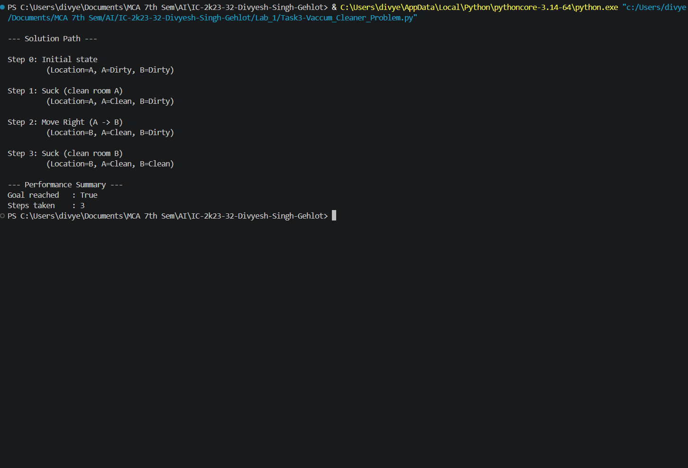

# 3. Vacuum Cleaner Problem

## 3.1 Aim / Problem Statement

### Aim
To implement the **Vacuum Cleaner Problem** as a production-rule-based simple reflex agent that cleans a two-room world.

### Problem Statement
A vacuum agent operates in a world of two rooms, A and B, each either Dirty or Clean. The agent can Suck (clean the current room) or Move to the other room. Starting from any configuration, the agent must reach a state where both rooms are Clean, using the minimum number of actions.

## 3.2 Algorithm

**State representation:** `(location, status_A, status_B)` where `location ∈ {A, B}` and `status_A, status_B ∈ {Dirty, Clean}` — 8 possible states in total.

**Production rules:**
```text
RULE 1: IF current room is Dirty          THEN Suck
RULE 2: IF current room is Clean AND at A THEN Move Right
RULE 3: IF current room is Clean AND at B THEN Move Left
```

### Pseudocode
```text
START
Set current_state = initial (location, status_A, status_B)

WHILE NOT (status_A = Clean AND status_B = Clean):
    IF current room is Dirty:
        Suck (clean current room)
    ELSE IF at room A:
        Move Right to B
    ELSE:
        Move Left to A
    Record state and action

Display "Goal reached"
END
```

## 3.3 Implementation

```python
"""
Vacuum Cleaner Problem
Solved using a Production Rule System (Simple Reflex Agent)
"""


class State:
    """Represents a state of the vacuum world."""

    def __init__(self, location, status_a, status_b):
        self.location = location
        self.status_a = status_a
        self.status_b = status_b

    def is_goal(self):
        """Goal state: both rooms are clean."""
        return self.status_a == "Clean" and self.status_b == "Clean"

    def current_status(self):
        """Return the dirt status of the room the vacuum is currently in."""
        return self.status_a if self.location == "A" else self.status_b

    def __repr__(self):
        return f"(Location={self.location}, A={self.status_a}, B={self.status_b})"


def apply_rule(state):
    """
    Production rules for the vacuum agent:
    RULE 1: IF current room is Dirty          THEN Suck
    RULE 2: IF current room is Clean AND at A THEN Move Right
    RULE 3: IF current room is Clean AND at B THEN Move Left
    """
    if state.current_status() == "Dirty":
        if state.location == "A":
            return State("A", "Clean", state.status_b), "Suck (clean room A)"
        else:
            return State("B", state.status_a, "Clean"), "Suck (clean room B)"

    elif state.location == "A":
        return State("B", state.status_a, state.status_b), "Move Right (A -> B)"

    else:
        return State("A", state.status_a, state.status_b), "Move Left (B -> A)"


def solve_vacuum(start_state, max_steps=20):
    """Run the production system until the goal state is reached."""
    trace = [(start_state, "Initial state")]
    current_state = start_state
    steps_taken = 0

    while not current_state.is_goal() and steps_taken < max_steps:
        next_state, action = apply_rule(current_state)
        trace.append((next_state, action))
        current_state = next_state
        steps_taken += 1

    return trace, steps_taken, current_state.is_goal()


def print_solution(trace):
    """Print the step-by-step trace of states and actions."""
    print("\n--- Solution Path ---\n")
    for i, (state, action) in enumerate(trace):
        print(f"Step {i}: {action}")
        print(f"         {state}\n")


def main():
    """Run the Vacuum Cleaner Problem."""
    try:
        start_state = State("A", "Dirty", "Dirty")
        trace, steps_taken, goal_reached = solve_vacuum(start_state)

        print_solution(trace)

        print("--- Performance Summary ---")
        print(f"Goal reached   : {goal_reached}")
        print(f"Steps taken    : {steps_taken}")

    except Exception as e:
        print(f"An error occurred while solving the problem: {e}")


if __name__ == "__main__":
    main()
```

## 3.4 Results / Output


```text
--- Solution Path ---

Step 0: Initial state
         (Location=A, A=Dirty, B=Dirty)

Step 1: Suck (clean room A)
         (Location=A, A=Clean, B=Dirty)

Step 2: Move Right (A -> B)
         (Location=B, A=Clean, B=Dirty)

Step 3: Suck (clean room B)
         (Location=B, A=Clean, B=Clean)

--- Performance Summary ---
Goal reached   : True
Steps taken    : 3
```

**Result:** Starting with both rooms dirty and the agent in room A, the goal (both rooms clean) is reached in 3 actions: Suck → Move Right → Suck.

## 3.5 Performance Analysis

| Metric | Result |
|---|---|
| Accuracy / Precision / Recall / F1 / Confusion Matrix | Not Applicable (reflex agent, not classification) |
| Steps to Goal (A=Dirty, B=Dirty, start=A) | 3 |
| Steps to Goal (A=Clean, B=Dirty, start=A) | 2 |
| Steps to Goal (A=Clean, B=Clean, start=A) | 0 |
| Time Complexity | O(1) per action (constant-time rule lookup) |
| Space Complexity | O(1) (no memory of past states needed — pure reflex agent) |

## 3.6 Screenshot
