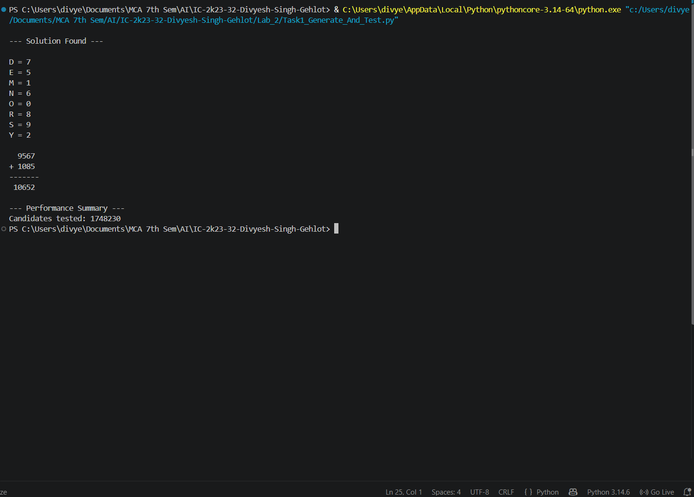

# 1. Generate and Test (SEND + MORE = MONEY)

## 1.1 Aim / Problem Statement

### Aim
To implement the **Generate and Test** technique in Python and use it to solve the **SEND + MORE = MONEY** cryptarithmetic puzzle by generating candidate digit assignments and testing each one against the puzzle constraints.

### Problem Statement
Each letter in `S, E, N, D, M, O, R, Y` stands for a different digit (0-9). Find the assignment for which:

```text
    S E N D
  + M O R E
  ---------
  M O N E Y
```

holds as an ordinary addition, with the extra rule that **S and M cannot be 0** (no number may start with zero).

### Example
```text
Letters : S E N D M O R Y   (8 distinct letters)
Digits  : 0 - 9             (each digit used at most once)
```

## 1.2 Algorithm

**State representation:** one *candidate* = a tuple of 8 distinct digits assigned to `(S, E, N, D, M, O, R, Y)`, for example `(0, 1, 2, 3, 4, 5, 6, 7)`.

Generate and Test has two separate parts:

| Part | Role in this program |
|---|---|
| **Generate** | `itertools.permutations(range(10), 8)` produces every possible assignment, one at a time, in lexicographic order |
| **Test** | `is_valid_assignment()` rejects leading zeros and checks `SEND + MORE == MONEY` |

### Pseudocode
```text
START
FOR EACH candidate in all permutations of 8 distinct digits from 0-9:
    Count the candidate
    Map letters to digits
    IF S = 0 OR M = 0:
        Reject candidate
    ELSE IF SEND + MORE = MONEY:
        Display solution
        STOP
    ELSE:
        Reject candidate

IF no candidate passed:
    Display "No solution found"
END
```

## 1.3 Implementation

```python
"""
Generate and Test — SEND + MORE = MONEY Cryptarithmetic Puzzle

Each letter (S, E, N, D, M, O, R, Y) represents a unique digit (0-9).
Constraints:
    - S and M cannot be 0 (no leading zero in a number).
    - SEND + MORE = MONEY must hold numerically.

Approach: GENERATE all possible digit assignments (permutations),
          TEST each one against the constraints until a valid one is found.
"""

from itertools import permutations


def word_to_number(word, mapping):
    """Convert a word to its numeric value using a letter-to-digit mapping."""
    return int("".join(str(mapping[letter]) for letter in word))


def is_valid_assignment(mapping):
    """Test whether a given letter-to-digit mapping solves the puzzle."""
    if mapping["S"] == 0 or mapping["M"] == 0:
        return False  # No leading zeros

    send = word_to_number("SEND", mapping)
    more = word_to_number("MORE", mapping)
    money = word_to_number("MONEY", mapping)

    return send + more == money


def generate_and_test():
    """
    GENERATE: produce every possible assignment of digits 0-9 to the
              8 distinct letters in SEND, MORE, MONEY.
    TEST:     check each candidate against the puzzle's constraints.
    """
    letters = "SENDMORY"  # 8 unique letters used across all three words
    digits = range(10)
    candidates_tested = 0

    for perm in permutations(digits, len(letters)):
        candidates_tested += 1
        mapping = dict(zip(letters, perm))

        if is_valid_assignment(mapping):
            return mapping, candidates_tested

    return None, candidates_tested


def print_solution(mapping):
    """Print the solved puzzle in a readable format."""
    send = word_to_number("SEND", mapping)
    more = word_to_number("MORE", mapping)
    money = word_to_number("MONEY", mapping)

    print("\n--- Solution Found ---\n")
    for letter in sorted(mapping):
        print(f"{letter} = {mapping[letter]}")

    print(f"\n  {send}")
    print(f"+ {more}")
    print(f"-------")
    print(f" {money}")


def main():
    """Run the Generate and Test algorithm on SEND + MORE = MONEY."""
    try:
        mapping, candidates_tested = generate_and_test()

        if mapping is None:
            print("No solution found.")
            return

        print_solution(mapping)

        print("\n--- Performance Summary ---")
        print(f"Candidates tested: {candidates_tested}")

    except Exception as e:
        print(f"An error occurred: {e}")


if __name__ == "__main__":
    main()
```

## 1.4 Results / Output

```text
--- Solution Found ---

D = 7
E = 5
M = 1
N = 6
O = 0
R = 8
S = 9
Y = 2

  9567
+ 1085
-------
 10652

--- Performance Summary ---
Candidates tested: 1748230
```

**Result:** the puzzle is solved with `S=9, E=5, N=6, D=7, M=1, O=0, R=8, Y=2`, i.e. **9567 + 1085 = 10652**.

## 1.5 Performance Analysis

| Metric | Result |
|---|---|
| Accuracy / Precision / Recall / F1 / Confusion Matrix | Not Applicable (not a classification problem) |
| Candidates tested | 1,748,230 |
| Size of the full search space | 1,814,400  (10P8 = 10! / 2!) |
| Fraction of the space searched | about 96.4 % |
| Execution time | about 8 seconds on the test machine (varies with hardware) |
| Time Complexity | O(N) with N = 1,814,400 candidates in the worst case (each test is a constant-size computation) |
| Space Complexity | O(1) - permutations are generated lazily, only the current candidate is stored |

Generate and Test is **brute force**: it has no knowledge of the problem, so it cannot skip bad regions of the search space. Two observations from this run:

* The first **181,440** candidates all have `S = 0`, so every one of them is rejected immediately by the leading-zero rule.
* The solution has `S = 9`, which sits very late in the lexicographic order, so almost the whole space (96.4 %) had to be generated before the answer appeared.

The search could be made far faster by *pruning* (for example, solving column by column and rejecting partial assignments early), which turns Generate and Test into constraint-based backtracking.

## 1.6 Screenshots / State Visualization

```text
Generate candidate
        │
        ▼
 Is S = 0 or M = 0? ──── yes ──► reject ──┐
        │ no                              │
        ▼                                 │
 SEND + MORE = MONEY? ── no ──► reject ───┤
        │ yes                             │
        ▼                                 ▼
  Solution found                  Generate next candidate
  9567 + 1085 = 10652
```



## 1.7 Learning Outcomes

* Understood the Generate and Test strategy and its two separate parts: a generator and a tester.
* Used `itertools.permutations` to generate a large search space lazily, without storing it.
* Saw why brute force is simple but expensive, and why pruning and constraints matter.
* Measured performance using the number of candidates tested instead of accuracy-style metrics.