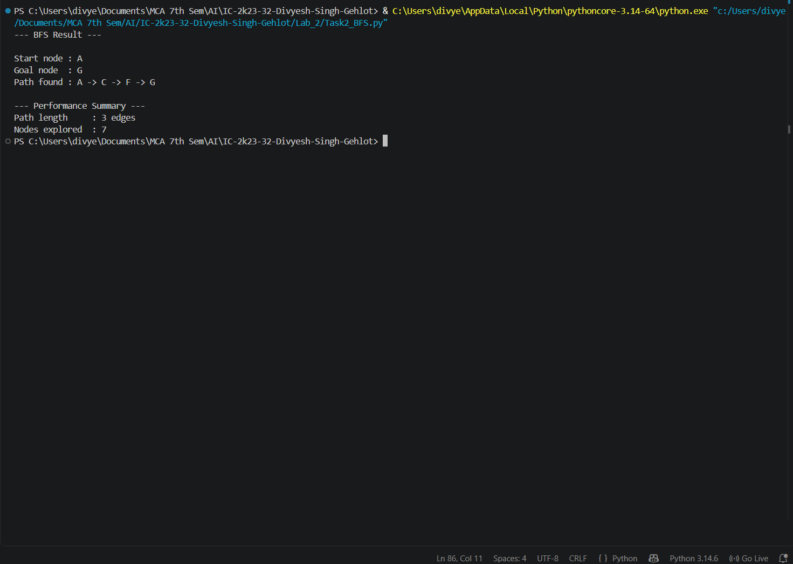
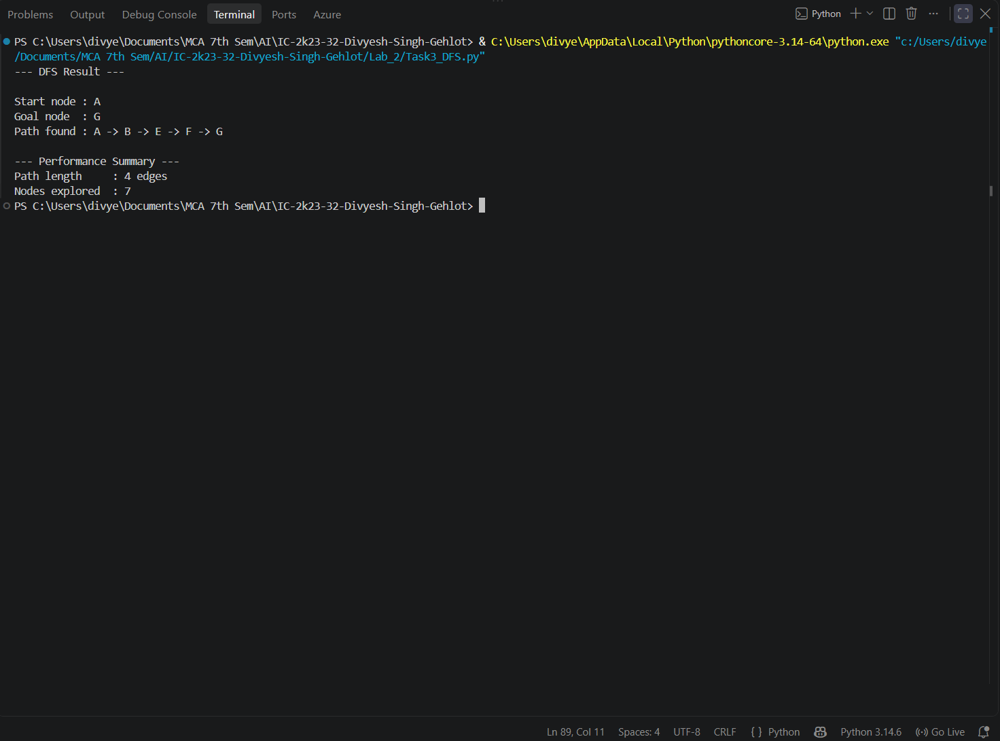

# 2. Breadth-First Search (BFS)

## 2.1 Aim / Problem Statement

### Aim
To implement **Breadth-First Search (BFS)** in Python and use it to find the shortest path between a start node and a goal node in an unweighted graph.

### Problem Statement
Given an unweighted graph stored as an adjacency list, a start node and a goal node, find the path with the **fewest edges** from start to goal, and report how many nodes the search had to explore.

### Example
The sample graph used in this lab (the same graph is reused for DFS, Hill Climbing, Best-First Search and A*):

```text
D ── B ── A ── C
     │         │
     E ─────── F ── G
```

| Node | Neighbours |
|---|---|
| A | B, C |
| B | A, D, E |
| C | A, F |
| D | B |
| E | B, F |
| F | C, E, G |
| G | F |

Start node = `A`, Goal node = `G`, every edge has cost 1.

## 2.2 Algorithm

**State representation:** a state is a node of the graph (`'A'` ... `'G'`). The program stores a whole *path* in the queue, so the route to each node is known without extra bookkeeping.

BFS uses a **FIFO queue**, so every node at distance 1 is explored before any node at distance 2, and so on.

### Pseudocode
```text
START
Create queue containing the path [start]
Mark start as visited

WHILE queue is not empty:
    Remove the first path from the queue
    current = last node of that path
    Count current as explored

    IF current = goal:
        RETURN path

    FOR EACH neighbour of current:
        IF neighbour is not visited:
            Mark neighbour as visited
            Add (path + neighbour) to the end of the queue

RETURN "No path found"
END
```

## 2.3 Implementation

```python
"""
Breadth-First Search (BFS) — Graph Traversal

Finds the shortest path (minimum number of edges) between a start
and goal node in an unweighted graph, represented as an adjacency list.
"""

from collections import deque


def bfs(graph, start, goal):
    """
    Perform BFS on 'graph' from 'start' to 'goal'.

    Parameters:
        graph (dict): adjacency list, e.g. {'A': ['B', 'C'], ...}
        start (str): starting node
        goal (str): target node

    Returns:
        path (list or None): sequence of nodes from start to goal
        nodes_explored (int): number of nodes dequeued during search
    """
    if start not in graph or goal not in graph:
        raise ValueError("Start or goal node not present in the graph.")

    visited = {start}
    queue = deque([[start]])  # queue of paths, not just nodes
    nodes_explored = 0

    while queue:
        path = queue.popleft()
        current_node = path[-1]
        nodes_explored += 1

        if current_node == goal:
            return path, nodes_explored

        for neighbour in graph.get(current_node, []):
            if neighbour not in visited:
                visited.add(neighbour)
                new_path = path + [neighbour]
                queue.append(new_path)

    return None, nodes_explored


def main():
    """Run BFS on a sample graph."""
    try:
        # Sample graph: could represent rooms in a maze, cities on a
        # route map, or nodes in any state-space problem.
        graph = {
            "A": ["B", "C"],
            "B": ["A", "D", "E"],
            "C": ["A", "F"],
            "D": ["B"],
            "E": ["B", "F"],
            "F": ["C", "E", "G"],
            "G": ["F"],
        }

        start_node = "A"
        goal_node = "G"

        path, nodes_explored = bfs(graph, start_node, goal_node)

        if path is None:
            print(f"No path found between {start_node} and {goal_node}.")
            return

        print("--- BFS Result ---\n")
        print(f"Start node : {start_node}")
        print(f"Goal node  : {goal_node}")
        print(f"Path found : {' -> '.join(path)}")

        print("\n--- Performance Summary ---")
        print(f"Path length     : {len(path) - 1} edges")
        print(f"Nodes explored  : {nodes_explored}")

    except Exception as e:
        print(f"An error occurred: {e}")


if __name__ == "__main__":
    main()
```

## 2.4 Results / Output

```text
--- BFS Result ---

Start node : A
Goal node  : G
Path found : A -> C -> F -> G

--- Performance Summary ---
Path length     : 3 edges
Nodes explored  : 7
```

**Result:** BFS finds the path `A -> C -> F -> G` with 3 edges, which is the shortest possible path in this graph.

**Order in which nodes were explored:** `A, B, C, D, E, F, G`

| Level (distance from A) | Nodes |
|---|---|
| 0 | A |
| 1 | B, C |
| 2 | D, E, F |
| 3 | G |

The goal is only detected when it is *removed* from the queue, so BFS explores all 7 nodes before returning, even though the answer is only 3 edges long.

## 2.5 Performance Analysis

| Metric | Result |
|---|---|
| Accuracy / Precision / Recall / F1 / Confusion Matrix | Not Applicable (not a classification problem) |
| Path length | 3 edges |
| Nodes explored | 7 |
| Optimal (shortest) path? | Yes - guaranteed for unweighted graphs |
| Execution time | about 3 microseconds per run (varies with hardware) |
| Time Complexity | O(V + E) |
| Space Complexity | O(V) for the queue and visited set (O(V x path length) here because whole paths are stored) |

BFS guarantees the shortest path in an unweighted graph, but it explores *level by level* and has no sense of direction, so it expanded every node in this graph. Its memory use grows with the width of the search, which is its main weakness on large graphs.

## 2.6 Screenshots / State Visualization

```text
BFS tree (each node is reached from its parent):

Level 0:            A
                  /   \
Level 1:         B     C
                / \     \
Level 2:       D   E     F
                           \
Level 3:                    G   <- goal reached via A -> C -> F -> G
```



## 2.7 Learning Outcomes

* Understood how a FIFO queue makes BFS explore level by level.
* Learned why BFS returns the shortest path in an unweighted graph.
* Stored paths in the queue to reconstruct the solution without parent pointers.
* Measured performance with path length and nodes explored.

---

# 3. Depth-First Search (DFS)

## 3.1 Aim / Problem Statement

### Aim
To implement **Depth-First Search (DFS)** in Python using an explicit stack, and compare its behaviour with BFS on the same graph.

### Problem Statement
Given an unweighted graph as an adjacency list, a start node and a goal node, find *a* path from start to goal by exploring as deep as possible along each branch before backtracking.

### Example
The same sample graph as BFS:

```text
D ── B ── A ── C
     │         │
     E ─────── F ── G
```

| Node | Neighbours |
|---|---|
| A | B, C |
| B | A, D, E |
| C | A, F |
| D | B |
| E | B, F |
| F | C, E, G |
| G | F |

Start node = `A`, Goal node = `G`, every edge has cost 1.

## 3.2 Algorithm

**State representation:** a state is a node of the graph. A stack of paths is used so the route to every node is remembered.

DFS uses a **LIFO stack**: the most recently discovered node is explored first, so the search goes deep and only backtracks at dead ends. Neighbours are pushed in reverse order so that the *first* neighbour in the list is explored first. An explicit stack is used instead of recursion to avoid Python's recursion-depth limit.

### Pseudocode
```text
START
Create stack containing the path [start]

WHILE stack is not empty:
    Remove the LAST path from the stack
    current = last node of that path

    IF current is already visited:
        CONTINUE
    Mark current as visited
    Count current as explored

    IF current = goal:
        RETURN path

    FOR EACH neighbour of current (in reverse order):
        IF neighbour is not visited:
            Push (path + neighbour) onto the stack

RETURN "No path found"
END
```

## 3.3 Implementation

```python
"""
Depth-First Search (DFS) — Graph Traversal

Explores as far as possible along each branch before backtracking.
Unlike BFS, DFS does NOT guarantee the shortest path — it guarantees
finding *a* path if one exists, using less memory than BFS.
"""


def dfs(graph, start, goal):
    """
    Perform DFS on 'graph' from 'start' to 'goal' using an explicit stack
    (iterative, not recursive — avoids Python's recursion depth limit).

    Parameters:
        graph (dict): adjacency list, e.g. {'A': ['B', 'C'], ...}
        start (str): starting node
        goal (str): target node

    Returns:
        path (list or None): sequence of nodes from start to goal
        nodes_explored (int): number of nodes popped during search
    """
    if start not in graph or goal not in graph:
        raise ValueError("Start or goal node not present in the graph.")

    visited = set()
    stack = [[start]]  # stack of paths, not just nodes
    nodes_explored = 0

    while stack:
        path = stack.pop()          # LIFO: take the most recently added path
        current_node = path[-1]

        if current_node in visited:
            continue

        visited.add(current_node)
        nodes_explored += 1

        if current_node == goal:
            return path, nodes_explored

        # Push neighbours in reverse so the first neighbour is explored first
        for neighbour in reversed(graph.get(current_node, [])):
            if neighbour not in visited:
                new_path = path + [neighbour]
                stack.append(new_path)

    return None, nodes_explored


def main():
    """Run DFS on the same sample graph used for BFS."""
    try:
        graph = {
            "A": ["B", "C"],
            "B": ["A", "D", "E"],
            "C": ["A", "F"],
            "D": ["B"],
            "E": ["B", "F"],
            "F": ["C", "E", "G"],
            "G": ["F"],
        }

        start_node = "A"
        goal_node = "G"

        path, nodes_explored = dfs(graph, start_node, goal_node)

        if path is None:
            print(f"No path found between {start_node} and {goal_node}.")
            return

        print("--- DFS Result ---\n")
        print(f"Start node : {start_node}")
        print(f"Goal node  : {goal_node}")
        print(f"Path found : {' -> '.join(path)}")

        print("\n--- Performance Summary ---")
        print(f"Path length     : {len(path) - 1} edges")
        print(f"Nodes explored  : {nodes_explored}")

    except Exception as e:
        print(f"An error occurred: {e}")


if __name__ == "__main__":
    main()
```

## 3.4 Results / Output

```text
--- DFS Result ---

Start node : A
Goal node  : G
Path found : A -> B -> E -> F -> G

--- Performance Summary ---
Path length     : 4 edges
Nodes explored  : 7
```

**Result:** DFS finds the path `A -> B -> E -> F -> G` with 4 edges. This is a valid path but **not the shortest one** (BFS found a 3-edge path).

**Order in which nodes were explored:** `A, B, D, E, F, C, G`

The order shows the depth-first behaviour: after `A` it dives into `B`, reaches the dead end `D`, backtracks to `E`, continues to `F`, and only then tries `C` before finally reaching `G`.

## 3.5 Performance Analysis

| Metric | Result |
|---|---|
| Accuracy / Precision / Recall / F1 / Confusion Matrix | Not Applicable (not a classification problem) |
| Path length | 4 edges |
| Nodes explored | 7 |
| Optimal (shortest) path? | No - DFS does not guarantee the shortest path |
| Execution time | about 7 microseconds per run (varies with hardware) |
| Time Complexity | O(V + E) |
| Space Complexity | O(V) for the stack and visited set (O(V x path length) here because whole paths are stored) |

| Algorithm | Path found | Path length | Nodes explored |
|---|---|---|---|
| BFS | A -> C -> F -> G | 3 | 7 |
| DFS | A -> B -> E -> F -> G | 4 | 7 |

Both explored all 7 nodes on this small graph, but DFS returned a *longer* path because it commits to the first branch it finds. In general DFS can use less memory than BFS on wide graphs, but it gives up the shortest-path guarantee.

## 3.6 Screenshots / State Visualization

```text
Exploration order (depth first): A, B, D, E, F, C, G

A ──► B ──► D              (dead end, backtrack to B)
      │
      └──► E ──► F ──► C   (dead end, backtrack to F)
                  │
                  └──► G   <- goal reached via A -> B -> E -> F -> G
```



## 3.7 Learning Outcomes

* Understood how a LIFO stack produces depth-first behaviour and backtracking.
* Saw that DFS finds a path but not necessarily the shortest one.
* Compared BFS and DFS on the same graph using path length and nodes explored.
* Used an iterative stack instead of recursion to avoid recursion-depth limits.