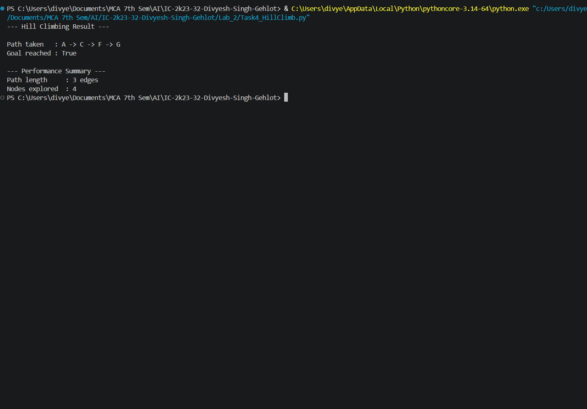

# 4. Hill Climbing Search

## 4.1 Aim / Problem Statement

### Aim
To implement **Simple Hill Climbing** in Python, a local search that repeatedly moves to the neighbour that looks closest to the goal according to a heuristic.

### Problem Statement
Starting from a start node, move step by step to the neighbouring node with the **lowest heuristic value** (closest estimated distance to the goal). Stop when the goal is reached, or when no neighbour is better than the current node (a *local optimum*).

### Example
The sample graph with a heuristic:

```text
D ── B ── A ── C
     │         │
     E ─────── F ── G
```

| Node | Neighbours |
|---|---|
| A | B, C |
| B | A, D, E |
| C | A, F |
| D | B |
| E | B, F |
| F | C, E, G |
| G | F |

Start node = `A`, Goal node = `G`, every edge has cost 1.

Heuristic `h(n)` = estimated number of edges from node `n` to the goal `G`:

| Node | A | B | C | D | E | F | G |
|---|---|---|---|---|---|---|---|
| h(n) | 3 | 3 | 2 | 4 | 2 | 1 | 0 |

## 4.2 Algorithm

**State representation:** a state is a node of the graph; its quality is measured by the heuristic `h(n)` (lower is better).

Hill Climbing keeps **no memory of other options** and never backtracks. It only looks at the neighbours of the current node.

### Pseudocode
```text
START
current = start
path = [current]

WHILE current is not the goal:
    IF current has no neighbours:
        STOP (dead end)

    best = neighbour of current with the lowest h(n)

    IF h(best) >= h(current):
        STOP (local optimum - no improvement)

    current = best
    Add current to path

Display path and whether the goal was reached
END
```

## 4.3 Implementation

```python
"""
Hill Climbing Search

At each step, moves to the neighbour with the lowest heuristic value
(closest estimated distance to goal). Stops when the goal is reached
or when no neighbour improves on the current node (local optimum) —
this is "Simple Hill Climbing" and does NOT backtrack.
"""


def hill_climbing(graph, heuristic, start, goal):
    """
    Parameters:
        graph (dict): adjacency list
        heuristic (dict): node -> estimated distance to goal
        start (str): starting node
        goal (str): target node

    Returns:
        path (list): sequence of nodes visited (may not reach goal)
        reached_goal (bool): whether the goal was actually reached
        nodes_explored (int): number of nodes visited
    """
    if start not in graph or goal not in graph:
        raise ValueError("Start or goal node not present in the graph.")

    current_node = start
    path = [current_node]
    nodes_explored = 1

    while current_node != goal:
        neighbours = graph.get(current_node, [])

        if not neighbours:
            break  # Dead end, no way forward

        # Pick the neighbour with the lowest heuristic value
        best_neighbour = min(neighbours, key=lambda n: heuristic[n])

        # Stop if no neighbour improves on the current node (local optimum)
        if heuristic[best_neighbour] >= heuristic[current_node]:
            break

        current_node = best_neighbour
        path.append(current_node)
        nodes_explored += 1

    return path, current_node == goal, nodes_explored


def main():
    """Run Hill Climbing on the sample graph."""
    try:
        graph = {
            "A": ["B", "C"], "B": ["A", "D", "E"], "C": ["A", "F"],
            "D": ["B"], "E": ["B", "F"], "F": ["C", "E", "G"], "G": ["F"],
        }
        heuristic = {"A": 3, "B": 3, "C": 2, "D": 4, "E": 2, "F": 1, "G": 0}

        start_node, goal_node = "A", "G"
        path, reached_goal, nodes_explored = hill_climbing(graph, heuristic, start_node, goal_node)

        print("--- Hill Climbing Result ---\n")
        print(f"Path taken   : {' -> '.join(path)}")
        print(f"Goal reached : {reached_goal}")

        print("\n--- Performance Summary ---")
        print(f"Path length     : {len(path) - 1} edges")
        print(f"Nodes explored  : {nodes_explored}")

    except Exception as e:
        print(f"An error occurred: {e}")


if __name__ == "__main__":
    main()
```

## 4.4 Results / Output

```text
--- Hill Climbing Result ---

Path taken   : A -> C -> F -> G
Goal reached : True

--- Performance Summary ---
Path length     : 3 edges
Nodes explored  : 4
```

**Result:** Hill Climbing reaches the goal with the path `A -> C -> F -> G`.

**Decision at each step:**

| Current node | Neighbours (h) | Best neighbour | Improves on current? |
|---|---|---|---|
| A (3) | B (3), C (2) | C (2) | Yes, move to C |
| C (2) | A (3), F (1) | F (1) | Yes, move to F |
| F (1) | C (2), E (2), G (0) | G (0) | Yes, move to G |
| G (0) | - | - | Goal reached |

## 4.5 Performance Analysis

| Metric | Result |
|---|---|
| Accuracy / Precision / Recall / F1 / Confusion Matrix | Not Applicable (not a classification problem) |
| Goal reached? | Yes |
| Path length | 3 edges |
| Nodes explored | 4 (only the nodes on the path, because there is no backtracking) |
| Optimal path? | Yes here, but not guaranteed |
| Execution time | about 6 microseconds per run (varies with hardware) |
| Time Complexity | O(L x b), L = number of steps taken, b = branching factor |
| Space Complexity | O(L) for the stored path (no frontier is kept) |

Hill Climbing is very cheap, but it is **neither complete nor optimal**. It can fail by getting stuck:

* **Local optimum:** a node whose neighbours are all no better than itself, even though the goal is reachable another way.
* **Plateau:** neighbours with equal heuristic values give no direction. This program uses `>=` in its stopping test, so equal values count as "no improvement" and the search stops instead of wandering. (This did not happen in this run, because every step improved on the last.)

It succeeded here because the heuristic improves at every step along the path. The result depends heavily on the quality of the heuristic.

## 4.6 Screenshots / State Visualization

```text
h(A)=3 ──► h(C)=2 ──► h(F)=1 ──► h(G)=0   (goal)
 start      lower       lower      lower

Each move goes "downhill" in h(n); the search stops when no
neighbour has a lower value than the current node.
```



## 4.7 Learning Outcomes

* Understood local search and how a heuristic guides each move.
* Learned the failure cases of Hill Climbing: local optima and plateaus.
* Saw why hill climbing explores only the nodes on its path.
* Compared a memory-less search with BFS and DFS.