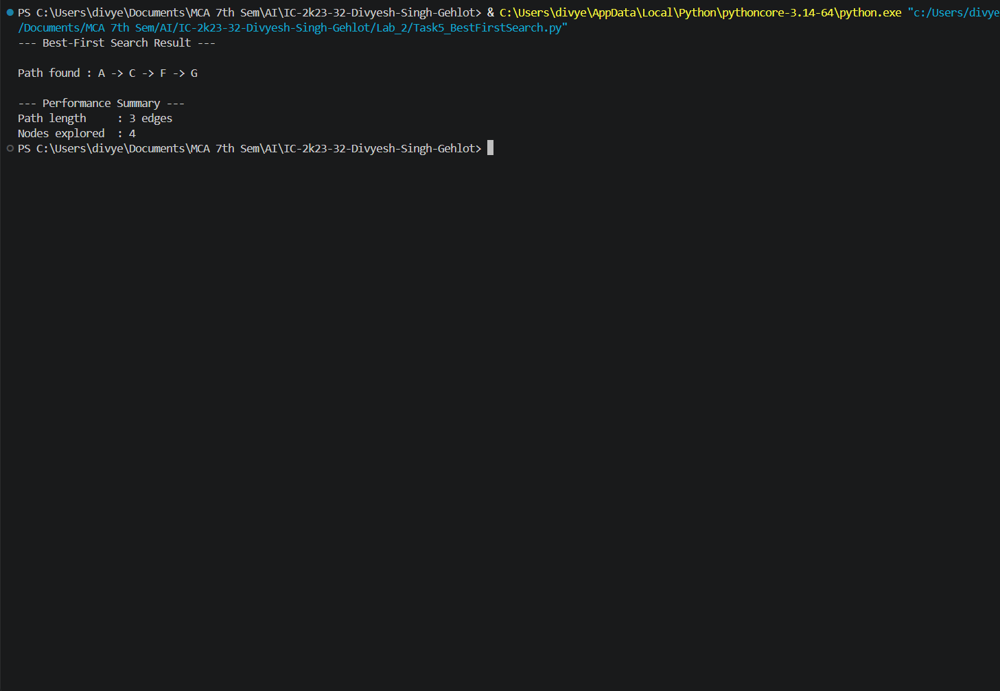

# 5. Greedy Best-First Search

## 5.1 Aim / Problem Statement

### Aim
To implement **Greedy Best-First Search** in Python using a priority queue ordered by the heuristic value `h(n)`.

### Problem Statement
Find a path from a start node to a goal node by always expanding the frontier node that **appears closest to the goal** (lowest `h(n)`), ignoring the cost already spent to reach it.

### Example
The sample graph with a heuristic:

```text
D ── B ── A ── C
     │         │
     E ─────── F ── G
```

| Node | Neighbours |
|---|---|
| A | B, C |
| B | A, D, E |
| C | A, F |
| D | B |
| E | B, F |
| F | C, E, G |
| G | F |

Start node = `A`, Goal node = `G`, every edge has cost 1.

Heuristic `h(n)` = estimated number of edges from node `n` to the goal `G`:

| Node | A | B | C | D | E | F | G |
|---|---|---|---|---|---|---|---|
| h(n) | 3 | 3 | 2 | 4 | 2 | 1 | 0 |

## 5.2 Algorithm

**State representation:** a state is a node of the graph. The frontier is a **priority queue** of `(h(n), node, path)` entries, so the most promising node is always removed first.

Unlike Hill Climbing, Best-First Search keeps the whole frontier, so it can switch to another branch if the current one turns out to be unpromising.

### Pseudocode
```text
START
Create priority queue with (h(start), start, [start])
visited = empty set

WHILE queue is not empty:
    Remove the entry with the LOWEST h(n)
    IF node already visited:
        CONTINUE
    Mark node as visited, count it as explored

    IF node = goal:
        RETURN path

    FOR EACH neighbour of node:
        IF neighbour is not visited:
            Add (h(neighbour), neighbour, path + neighbour) to the queue

RETURN "No path found"
END
```

## 5.3 Implementation

```python
"""
Greedy Best-First Search

Expands the node in the frontier with the lowest heuristic value h(n),
ignoring the cost already spent to reach it (unlike A*). Faster than
A* in practice but not guaranteed to find the shortest path.
"""

import heapq


def best_first_search(graph, heuristic, start, goal):
    """
    Parameters:
        graph (dict): adjacency list
        heuristic (dict): node -> estimated distance to goal
        start (str): starting node
        goal (str): target node

    Returns:
        path (list or None): sequence of nodes from start to goal
        nodes_explored (int): number of nodes popped from the frontier
    """
    if start not in graph or goal not in graph:
        raise ValueError("Start or goal node not present in the graph.")

    # Priority queue entries: (heuristic_value, node, path_so_far)
    frontier = [(heuristic[start], start, [start])]
    visited = set()
    nodes_explored = 0

    while frontier:
        h_value, current_node, path = heapq.heappop(frontier)

        if current_node in visited:
            continue

        visited.add(current_node)
        nodes_explored += 1

        if current_node == goal:
            return path, nodes_explored

        for neighbour in graph.get(current_node, []):
            if neighbour not in visited:
                new_path = path + [neighbour]
                heapq.heappush(frontier, (heuristic[neighbour], neighbour, new_path))

    return None, nodes_explored


def main():
    """Run Greedy Best-First Search on the sample graph."""
    try:
        graph = {
            "A": ["B", "C"], "B": ["A", "D", "E"], "C": ["A", "F"],
            "D": ["B"], "E": ["B", "F"], "F": ["C", "E", "G"], "G": ["F"],
        }
        heuristic = {"A": 3, "B": 3, "C": 2, "D": 4, "E": 2, "F": 1, "G": 0}

        start_node, goal_node = "A", "G"
        path, nodes_explored = best_first_search(graph, heuristic, start_node, goal_node)

        if path is None:
            print(f"No path found between {start_node} and {goal_node}.")
            return

        print("--- Best-First Search Result ---\n")
        print(f"Path found : {' -> '.join(path)}")

        print("\n--- Performance Summary ---")
        print(f"Path length     : {len(path) - 1} edges")
        print(f"Nodes explored  : {nodes_explored}")

    except Exception as e:
        print(f"An error occurred: {e}")


if __name__ == "__main__":
    main()
```

## 5.4 Results / Output

```text
--- Best-First Search Result ---

Path found : A -> C -> F -> G

--- Performance Summary ---
Path length     : 3 edges
Nodes explored  : 4
```

**Result:** Greedy Best-First Search finds `A -> C -> F -> G`.

**Trace of the priority queue:**

| Step | Node removed (h) | Added to frontier (h) |
|---|---|---|
| 1 | A (3) | B (3), C (2) |
| 2 | C (2) | F (1)  (A already visited) |
| 3 | F (1) | E (2), G (0)  (C already visited) |
| 4 | G (0) | goal reached |

Nodes explored in order: `A, C, F, G`. `B`, `D` and `E` were never expanded.

## 5.5 Performance Analysis

| Metric | Result |
|---|---|
| Accuracy / Precision / Recall / F1 / Confusion Matrix | Not Applicable (not a classification problem) |
| Path length | 3 edges |
| Nodes explored | 4 |
| Optimal path? | Yes here, but not guaranteed in general |
| Execution time | about 3 microseconds per run (varies with hardware) |
| Time Complexity | O(E log V) with a binary heap (worst case exponential in the search depth for large trees) |
| Space Complexity | O(V) for the frontier and visited set |

Best-First Search explored only 4 of the 7 nodes, compared with 7 for BFS and DFS, because the heuristic pointed it straight at the goal.

**Caveat:** it uses only `h(n)` and ignores the cost of the path so far, so with a misleading heuristic it can return a long path. It is fast but not optimal. In this graph the heuristic happens to equal the true distance to the goal at every node, which is why the greedy choice works so well here.

## 5.6 Screenshots / State Visualization

```text
Frontier (lowest h first)

Step 1:  [A(3)]                    → expand A
Step 2:  [C(2), B(3)]              → expand C
Step 3:  [F(1), B(3)]              → expand F
Step 4:  [G(0), E(2), B(3)]        → expand G  (goal)
```



## 5.7 Learning Outcomes

* Understood how a priority queue implements an informed search.
* Learned the difference between greedy search (uses h only) and A* (uses g + h).
* Saw how a good heuristic reduces the number of nodes explored.
* Recognised that greedy search is fast but not guaranteed to be optimal.