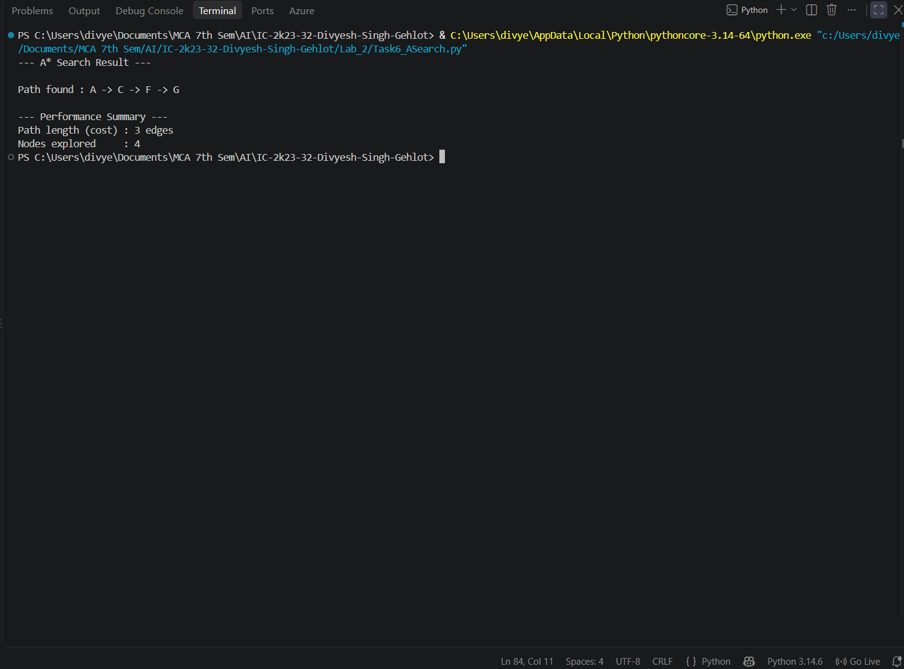

# 6. A* Search

## 6.1 Aim / Problem Statement

### Aim
To implement the **A\* Search** algorithm in Python, combining the actual cost from the start with a heuristic estimate to the goal, in order to find the shortest path efficiently.

### Problem Statement
Find the lowest-cost path from a start node to a goal node by always expanding the frontier node with the smallest value of

```text
f(n) = g(n) + h(n)
```

where `g(n)` is the actual cost from the start to `n` and `h(n)` is the heuristic estimate from `n` to the goal.

### Example
The sample graph with a heuristic (every edge has cost 1):

```text
D ── B ── A ── C
     │         │
     E ─────── F ── G
```

| Node | Neighbours |
|---|---|
| A | B, C |
| B | A, D, E |
| C | A, F |
| D | B |
| E | B, F |
| F | C, E, G |
| G | F |

Start node = `A`, Goal node = `G`, every edge has cost 1.

Heuristic `h(n)` = estimated number of edges from node `n` to the goal `G`:

| Node | A | B | C | D | E | F | G |
|---|---|---|---|---|---|---|---|
| h(n) | 3 | 3 | 2 | 4 | 2 | 1 | 0 |

## 6.2 Algorithm

**State representation:** a state is a node of the graph. The frontier is a priority queue of `(f, g, node, path)` entries ordered by `f(n)`.

| Term | Meaning |
|---|---|
| `g(n)` | actual cost from the start to `n` (number of edges) |
| `h(n)` | heuristic estimate from `n` to the goal |
| `f(n) = g(n) + h(n)` | estimated total cost of a path through `n` |

A* is guaranteed to return the shortest path as long as `h(n)` is **admissible** (never overestimates the true cost).

### Pseudocode
```text
START
Create priority queue with (h(start), 0, start, [start])
visited = empty set

WHILE queue is not empty:
    Remove the entry with the LOWEST f = g + h
    IF node already visited:
        CONTINUE
    Mark node as visited, count it as explored

    IF node = goal:
        RETURN path and g

    FOR EACH neighbour of node:
        IF neighbour is not visited:
            new_g = g + 1
            new_f = new_g + h(neighbour)
            Add (new_f, new_g, neighbour, path + neighbour) to the queue

RETURN "No path found"
END
```

## 6.3 Implementation

```python
"""
A* Search

Expands the node in the frontier with the lowest f(n) = g(n) + h(n),
where g(n) is the actual cost from start to n, and h(n) is the
heuristic estimate from n to goal. Guarantees the shortest path
as long as the heuristic is admissible (never overestimates).
"""

import heapq


def a_star_search(graph, heuristic, start, goal):
    """
    Parameters:
        graph (dict): adjacency list (unit edge cost assumed)
        heuristic (dict): node -> estimated distance to goal
        start (str): starting node
        goal (str): target node

    Returns:
        path (list or None): sequence of nodes from start to goal
        total_cost (int or None): g(n) of the goal node (path length)
        nodes_explored (int): number of nodes popped from the frontier
    """
    if start not in graph or goal not in graph:
        raise ValueError("Start or goal node not present in the graph.")

    # Priority queue entries: (f_value, g_value, node, path_so_far)
    frontier = [(heuristic[start], 0, start, [start])]
    visited = set()
    nodes_explored = 0

    while frontier:
        f_value, g_value, current_node, path = heapq.heappop(frontier)

        if current_node in visited:
            continue

        visited.add(current_node)
        nodes_explored += 1

        if current_node == goal:
            return path, g_value, nodes_explored

        for neighbour in graph.get(current_node, []):
            if neighbour not in visited:
                new_g = g_value + 1  # unit edge cost
                new_f = new_g + heuristic[neighbour]
                new_path = path + [neighbour]
                heapq.heappush(frontier, (new_f, new_g, neighbour, new_path))

    return None, None, nodes_explored


def main():
    """Run A* Search on the sample graph."""
    try:
        graph = {
            "A": ["B", "C"], "B": ["A", "D", "E"], "C": ["A", "F"],
            "D": ["B"], "E": ["B", "F"], "F": ["C", "E", "G"], "G": ["F"],
        }
        heuristic = {"A": 3, "B": 3, "C": 2, "D": 4, "E": 2, "F": 1, "G": 0}

        start_node, goal_node = "A", "G"
        path, total_cost, nodes_explored = a_star_search(graph, heuristic, start_node, goal_node)

        if path is None:
            print(f"No path found between {start_node} and {goal_node}.")
            return

        print("--- A* Search Result ---\n")
        print(f"Path found : {' -> '.join(path)}")

        print("\n--- Performance Summary ---")
        print(f"Path length (cost) : {total_cost} edges")
        print(f"Nodes explored     : {nodes_explored}")

    except Exception as e:
        print(f"An error occurred: {e}")


if __name__ == "__main__":
    main()
```

## 6.4 Results / Output

```text
--- A* Search Result ---

Path found : A -> C -> F -> G

--- Performance Summary ---
Path length (cost) : 3 edges
Nodes explored     : 4
```

**Result:** A* finds `A -> C -> F -> G` with cost 3.

**Nodes expanded:**

| Order | Node | g(n) | h(n) | f(n) = g + h |
|---|---|---|---|---|
| 1 | A | 0 | 3 | 3 |
| 2 | C | 1 | 2 | 3 |
| 3 | F | 2 | 1 | 3 |
| 4 | G | 3 | 0 | 3 |

## 6.5 Performance Analysis

| Metric | Result |
|---|---|
| Accuracy / Precision / Recall / F1 / Confusion Matrix | Not Applicable (not a classification problem) |
| Path length (cost) | 3 edges |
| Nodes explored | 4 |
| Optimal path? | Yes - guaranteed when the heuristic is admissible |
| Execution time | about 2 microseconds per run (varies with hardware) |
| Time Complexity | O(E log V) with a binary heap (worst case exponential in the solution depth) |
| Space Complexity | O(V) for the frontier and visited set |

**Admissibility check:** the true number of edges to `G` is A=3, B=3, C=2, D=4, E=2, F=1, G=0, which is exactly the heuristic table. The heuristic therefore never overestimates, so it is admissible (and in fact perfect). That explains why `f(n) = 3` for every node on the path: A* walked straight along the optimal route.

### Comparison of all five graph-search programs (same graph)

| Algorithm | Path | Length | Nodes explored | Optimal? |
|---|---|---|---|---|
| BFS | A -> C -> F -> G | 3 | 7 | Yes |
| DFS | A -> B -> E -> F -> G | 4 | 7 | No |
| Hill Climbing | A -> C -> F -> G | 3 | 4 | Not guaranteed |
| Best-First Search | A -> C -> F -> G | 3 | 4 | Not guaranteed |
| A* | A -> C -> F -> G | 3 | 4 | Yes (admissible h) |

**Caveat:** because the heuristic here is perfect, the informed algorithms look better than they would with a rougher heuristic. To see their differences clearly, test them on a graph with a misleading heuristic or non-uniform edge costs.

## 6.6 Screenshots / State Visualization

```text
 f = g + h                         path cost g

 A   0 + 3 = 3   ──►  C   1 + 2 = 3   ──►  F   2 + 1 = 3   ──►  G   3 + 0 = 3
 (start)                                                       (goal)
```



## 6.7 Learning Outcomes

* Understood the A* evaluation function f(n) = g(n) + h(n).
* Learned what an admissible heuristic is and why it guarantees optimality.
* Compared all five graph-search programs using path length and nodes explored.
* Recognised that the results depend on the quality of the heuristic.