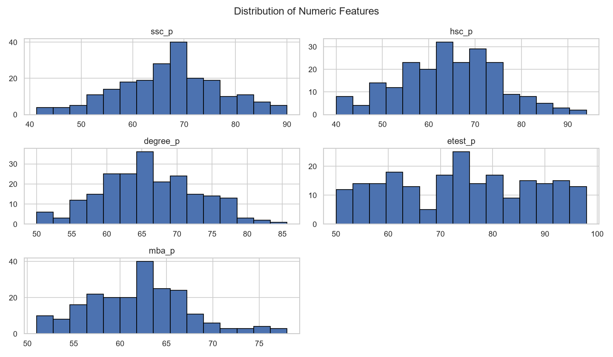
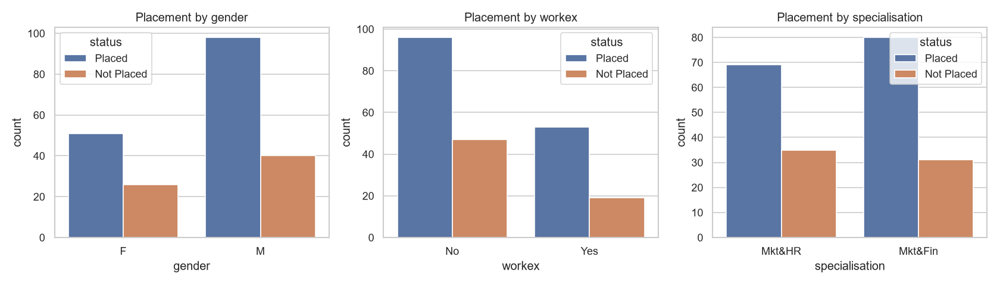
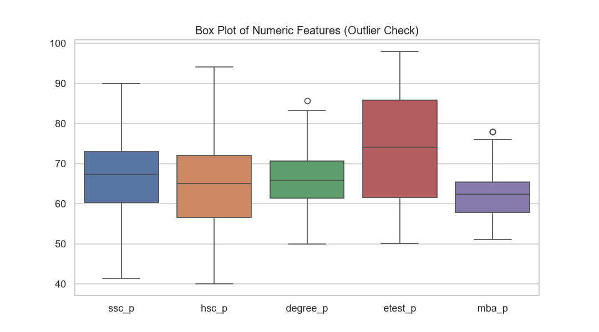
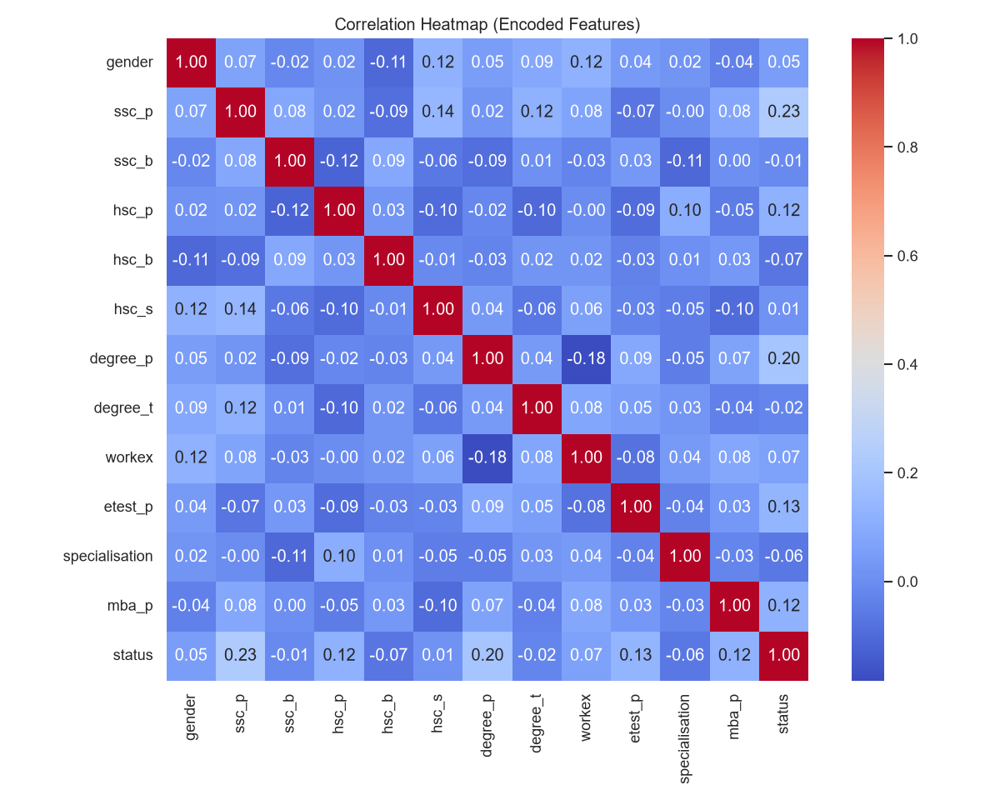
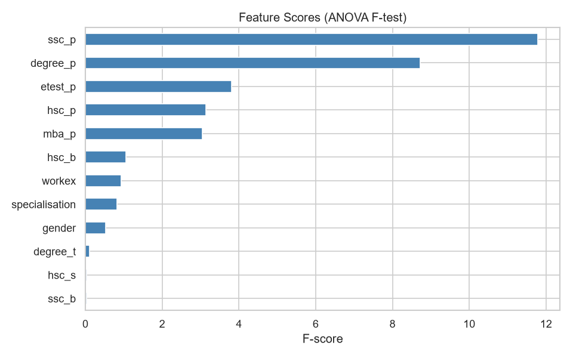

# 📊 Lab 9-10-11 — AI Programming Frameworks & Data Preparation

## Overview

These lab builds a complete **data preprocessing pipeline** on a Student Placement dataset using NumPy, Pandas, Matplotlib/Seaborn and Scikit-learn. It covers dataset loading, EDA, cleaning, missing value handling, label encoding, feature selection and visualization, followed by an experimental analysis of preprocessing techniques and feature engineering.

```text
Lab_3/
├── data_preprocessing.py          # Main pipeline (7 topics)
├── preprocessing_comparison.py    # Analysis experiments (homework)
├── outputs/
│   ├── 01_numeric_distributions.png
│   ├── 02_placement_by_category.png
│   ├── 03_boxplot_outliers.png
│   ├── 04_correlation_heatmap.png
│   ├── 05_feature_scores.png
│   └── preprocessing_comparison.csv
└── README.md
datasets/
├── placement.csv
└── placement_processed.csv
```

> **Dataset note:** the results below were produced on a **sample dataset generated by the script** (215 students, same columns as the Kaggle *Campus Recruitment* dataset). If you replace `datasets/placement.csv` with the real dataset, re-run both scripts and update the numbers in this README.

---

# 1. Aim / Problem Statement

### Aim

To build a reusable data preprocessing pipeline that converts a raw, messy student placement dataset into a clean, numeric, model-ready dataset, and to analyse how different preprocessing choices affect results.

### Problem Statement

The raw dataset contains duplicate rows, missing values, inconsistent text (`m` vs `M`), categorical columns that models cannot read, and a mix of useful and irrelevant features. The pipeline must:

1. Load the dataset safely.
2. Explore its structure and quality (EDA).
3. Clean duplicates and inconsistent values.
4. Handle missing values appropriately.
5. Encode categorical variables numerically.
6. Select the most informative features.
7. Visualize distributions, relationships and feature importance.

### Dataset Description

| Column | Type | Description |
|---|---|---|
| `gender` | Categorical | M / F |
| `ssc_p`, `hsc_p` | Numeric | Secondary / higher secondary percentage |
| `ssc_b`, `hsc_b` | Categorical | Board of education (Central / Others) |
| `hsc_s` | Categorical | Higher secondary stream |
| `degree_p`, `degree_t` | Numeric / Categorical | Degree percentage and type |
| `workex` | Categorical | Work experience (Yes / No) |
| `etest_p` | Numeric | Employability test percentage |
| `specialisation` | Categorical | MBA specialisation |
| `mba_p` | Numeric | MBA percentage |
| `status` | **Target** | Placed / Not Placed |
| `salary` | Numeric | Offered salary (only for placed students) |

---

# 2. Algorithm

The pipeline runs seven sequential stages:

```text
Load → EDA → Clean → Handle Missing → Encode → Select Features → Visualize
```

### Pseudocode

```text
START
1. LOAD dataset from CSV (generate sample if file is missing)
2. EDA: print shape, dtypes, statistics, missing counts, duplicates, class balance
3. CLEAN:
     remove duplicate rows
     strip whitespace and standardise case in text columns
     drop the ID column (sl_no)
     mark out-of-range percentages (<0 or >100) as missing
4. MISSING VALUES:
     numeric columns      -> fill with median
     categorical columns  -> fill with mode
     salary               -> fill with 0 (NaN means "not placed")
5. ENCODE: apply LabelEncoder to every categorical column and the target
6. SELECT FEATURES:
     exclude 'salary' (data leakage)
     rank features by |correlation| with target and ANOVA F-score
     keep top K features
7. VISUALIZE: histograms, count plots, box plots, heatmap, feature scores
8. SAVE processed dataset
END
```

### Design Decisions

| Decision | Reason |
|---|---|
| Median (not mean) for numeric imputation | Robust to outliers |
| `salary` NaN → 0 | NaN means "no job offered", not "unknown" |
| `salary` excluded from features | Known only *after* placement — using it would leak the answer |
| `LabelEncoder` | Simple, compact; suitable for tree-based models |
| `SelectKBest(f_classif)` | Fast, interpretable, univariate ranking |

---

# 3. Implementation

The full code is in [`data_preprocessing.py`](data_preprocessing.py). Each topic is a separate, reusable function:

| Topic | Function |
|---|---|
| Dataset Loading | `load_dataset()` |
| EDA | `explore_data()` |
| Data Cleaning | `clean_data()` |
| Missing Value Handling | `handle_missing_values()`, `compare_missing_strategies()` |
| Label Encoding | `encode_labels()` |
| Feature Selection | `select_features()` |
| Data Visualization | `visualize_data()` |

### Key Snippets

**Missing value handling**

```python
def handle_missing_values(df):
    imputed = df.copy()
    for column in NUMERIC_COLUMNS:
        imputed[column] = imputed[column].fillna(imputed[column].median())
    for column in CATEGORICAL_COLUMNS:
        imputed[column] = imputed[column].fillna(imputed[column].mode()[0])
    imputed["salary"] = imputed["salary"].fillna(0)
    return imputed
```

**Label encoding**

```python
def encode_labels(df):
    encoded = df.copy()
    for column in CATEGORICAL_COLUMNS + [TARGET_COLUMN]:
        encoder = LabelEncoder()
        encoded[column] = encoder.fit_transform(encoded[column].astype(str))
    return encoded
```

**Feature selection**

```python
features = df.drop(columns=[TARGET_COLUMN, "salary"])
selector = SelectKBest(score_func=f_classif, k=5).fit(features, df[TARGET_COLUMN])
selected = list(features.columns[selector.get_support()])
```

### How to Run

```bash
pip install pandas numpy matplotlib seaborn scikit-learn
cd Lab_3
python data_preprocessing.py        # main pipeline + plots
python preprocessing_comparison.py  # homework analysis experiments
```

---

# 4. Results / Output

### Dataset Loading and EDA

```text
Loaded 219 rows, 15 columns

Shape: 219 rows x 15 columns

Missing values per column:
ssc_p       6
hsc_p       6
hsc_s       4
etest_p     7
mba_p       6
salary     68

Duplicate rows: 4

Target distribution ('status'):
Placed        151
Not Placed     68
```

### Data Cleaning

```text
Removed 4 duplicate rows.
```

Rows after cleaning: **215**. Inconsistent gender labels (`m`, `f`) were standardised to upper case and the `sl_no` ID column was dropped.

### Missing Value Handling

```text
ssc_p: filled 6 missing with median = 67.33
hsc_p: filled 6 missing with median = 64.94
etest_p: filled 6 missing with median = 74.01
mba_p: filled 6 missing with median = 62.32
hsc_s: filled 4 missing with mode = 'Commerce'
Missing values remaining: 0
```

### Label Encoding

```text
gender:         {'F': 0, 'M': 1}
ssc_b:          {'Central': 0, 'Others': 1}
hsc_b:          {'Central': 0, 'Others': 1}
hsc_s:          {'Arts': 0, 'Commerce': 1, 'Science': 2}
degree_t:       {'Comm&Mgmt': 0, 'Others': 1, 'Sci&Tech': 2}
workex:         {'No': 0, 'Yes': 1}
specialisation: {'Mkt&Fin': 0, 'Mkt&HR': 1}
status:         {'Not Placed': 0, 'Placed': 1}
```

### Feature Selection

| Rank | Feature | \|Correlation\| with target | ANOVA F-score |
|---|---|---|---|
| 1 | `ssc_p` | 0.229 | 11.78 |
| 2 | `degree_p` | 0.198 | 8.71 |
| 3 | `etest_p` | 0.132 | 3.81 |
| 4 | `hsc_p` | 0.120 | 3.13 |
| 5 | `mba_p` | 0.119 | 3.04 |
| 6 | `hsc_b` | 0.070 | 1.06 |
| 7 | `workex` | 0.066 | 0.94 |
| 8 | `specialisation` | 0.062 | 0.82 |
| 9 | `gender` | 0.050 | 0.53 |
| 10 | `degree_t` | 0.022 | 0.10 |
| 11 | `hsc_s` | 0.011 | 0.03 |
| 12 | `ssc_b` | 0.011 | 0.03 |

**Selected features (top 5):** `ssc_p`, `hsc_p`, `degree_p`, `etest_p`, `mba_p`

### Final Result

A clean dataset with **215 rows, no missing values, all columns numeric**, saved as `datasets/placement_processed.csv`.

---

# 5. Performance Analysis

Since this lab is a preprocessing pipeline and not a classifier, accuracy, precision, recall and F1 are not applicable to the pipeline itself. They are used in Section 9 only to compare preprocessing choices indirectly.

| Metric | Result |
|---|---|
| Rows before / after cleaning | 219 → 215 |
| Duplicate rows removed | 4 |
| Missing values handled | 28 feature values (+ 68 salary values encoded as 0) |
| Missing values remaining | 0 |
| Columns encoded | 8 (7 features + target) |
| Features selected | 5 of 12 |
| Execution time (full pipeline incl. plots) | ≈ 1.5 s |
| Time complexity | O(n · m) for n rows and m columns (feature scoring adds a small per-feature cost) |
| Space complexity | O(n · m) — a copy of the DataFrame is held at each stage |

### Class Balance

| Class | Count | Share |
|---|---|---|
| Placed | 151 | 69.3 % |
| Not Placed | 68 | 30.7 % |

The classes are imbalanced (roughly 70:30), so plain accuracy can be misleading for later modelling — a model that always predicts "Placed" already scores about 69 %.

---

# 6. Screenshots / Graphs / Visualization

### Numeric Feature Distributions



### Placement by Category



### Box Plot (Outlier Check)



### Correlation Heatmap



### Feature Scores (ANOVA F-test)



### Console Output

Add a screenshot of your terminal run here:

```text

```

### Confusion Matrix

```text
Not Applicable — no classifier is trained in this lab (see Lab 5).
```

---

# 7. Input Validation and Exception Handling

- **Missing file:** `load_dataset()` generates a sample dataset instead of crashing.
- **Corrupt or empty file:** `pd.errors.EmptyDataError` and `pd.errors.ParserError` are caught and re-raised as clear `ValueError` messages.
- **Invalid values:** percentages outside 0–100 are converted to missing and then imputed.
- **Pipeline-level handling:** `main()` catches `ValueError`, `KeyError` and `OSError` and reports a readable error.
- **Safe copies:** every stage works on `df.copy()` so the raw data is never modified in place.

---

# 8. Coding Standards Followed

- **Modular and reusable code:** one function per pipeline stage, with constants (`CATEGORICAL_COLUMNS`, `NUMERIC_COLUMNS`, `TARGET_COLUMN`) defined once at the top.
- **Meaningful names:** `handle_missing_values`, `feature_scores`, `median_value`, etc.
- **Comments:** every function has a short comment explaining what it does and why.
- **Exception handling:** described in Section 7.
- **PEP-8:** 4-space indentation, `snake_case`, grouped imports, readable line lengths.
- **Reproducibility:** fixed random seeds (`seed=42`, `random_state=42`).

---

# 9. Analysis (Homework)

## 9.1 Compare Preprocessing Techniques

Five preprocessing choices were compared with `preprocessing_comparison.py`, using **5-fold stratified cross-validated accuracy** with Logistic Regression and a depth-4 Decision Tree.

| Experiment | Technique | Model | Rows | CV Accuracy (%) | Std (%) |
|---|---|---|---|---|---|
| Missing values | Drop rows with NaN | Logistic Regression | 190 | 68.95 | 5.10 |
| Missing values | Drop rows with NaN | Decision Tree | 190 | 65.79 | 6.23 |
| Missing values | Median / mode imputation | Logistic Regression | 215 | 67.91 | 6.14 |
| Missing values | Median / mode imputation | Decision Tree | 215 | 65.58 | 4.97 |
| Encoding | Label (ordinal) encoding | Logistic Regression | 215 | 69.30 | 4.74 |
| Encoding | Label (ordinal) encoding | Decision Tree | 215 | 66.98 | 4.00 |
| Encoding | One-hot encoding | Logistic Regression | 215 | 67.91 | 6.14 |
| Encoding | One-hot encoding | Decision Tree | 215 | 65.58 | 4.97 |
| Scaling | No scaling | Logistic Regression | 215 | 68.37 | 6.17 |
| Scaling | StandardScaler | Logistic Regression | 215 | 67.91 | 6.14 |

**Majority-class baseline: 69.30 %.**

### Interpretation

- **Missing values — dropping vs imputing.** Dropping rows lost 25 of 215 students (≈ 12 %) for roughly equal accuracy. Imputation keeps all the data, which matters more when the dataset is small, at the cost of slightly shrinking variance (the standard deviation of `etest_p` fell from 13.87 to 13.68 after imputation).
- **Label vs one-hot encoding.** Label encoding invents an order (Arts < Commerce < Science) that does not exist, while one-hot encoding avoids this at the cost of more columns. Both performed similarly here, because most categorical features carry little signal. Label encoding is fine for trees; linear models are the safer choice for one-hot.
- **Scaling.** Scaling makes no meaningful difference to tree models (they are scale-invariant) and only helps linear models converge and regularise fairly.

### Important Caveat

**Every accuracy in the table is within about one standard deviation of the 69.30 % majority baseline, and the differences between techniques (1–3 points) are smaller than the fold-to-fold std (4–6 points).** On this sample data, none of the techniques can be declared the winner; the table shows how to run the comparison, not a proven ranking. Re-run it on the real dataset, which has stronger signal, before drawing conclusions.

## 9.2 Evaluate the Impact of Feature Engineering

Two features were engineered from existing columns:

- `avg_academic` = mean of `ssc_p`, `hsc_p` and `degree_p` (overall academic strength).
- `academic_trend` = `degree_p − ssc_p` (improving or declining performance).

| Model | Original features | + Engineered features | Change |
|---|---|---|---|
| Logistic Regression | 67.91 % | 68.37 % | +0.46 |
| Decision Tree | 65.58 % | 66.05 % | +0.47 |

### Feature Selection (Related Result)

| Model | All 12 features | Top 5 (SelectKBest) | Change |
|---|---|---|---|
| Logistic Regression | 67.91 % | 70.70 % | +2.79 |
| Decision Tree | 65.58 % | 66.98 % | +1.40 |

### Interpretation

- The engineered features gave a small positive change of about 0.5 points for both models. That is far smaller than the 5–6 point std, so the effect is **not statistically meaningful** on this data.
- Selecting the top 5 features gave the largest change (+2.79 for Logistic Regression). Removing weak features such as `ssc_b` and `hsc_s` (F-score ≈ 0.03) reduces noise and helps especially for small datasets with many weak features. This is also still within noise, but the direction is consistent for both models.
- Feature engineering helps most when the new feature captures a relationship the model cannot learn easily by itself (linear models cannot form `degree_p − ssc_p` unaided; trees can approximate it with splits).

---

# 10. Learning Outcomes

- Loaded and inspected a dataset with Pandas, and read its structure, dtypes and statistics.
- Performed EDA to find missing values, duplicates, imbalance and outliers.
- Cleaned inconsistent text and invalid values.
- Chose imputation strategies by data type and by meaning (salary `NaN` ≠ unknown).
- Applied label encoding and understood its limits compared to one-hot encoding.
- Used correlation and ANOVA F-scores for feature selection, and recognised **data leakage** (`salary`).
- Created histograms, count plots, box plots, a correlation heatmap and feature-score charts with Matplotlib and Seaborn.
- Learned to compare preprocessing choices with cross-validation, and to read results against a **majority-class baseline** and the fold-to-fold variance instead of trusting small differences.

---

# 11. Conclusion

A modular preprocessing pipeline was built that loads the placement dataset, explores it, removes 4 duplicates, imputes all missing values, encodes 8 categorical columns, and selects the 5 most informative features, producing a clean model-ready dataset in about 1.5 seconds. The comparison experiments show how to evaluate preprocessing decisions rigorously: on this small sample dataset the differences between techniques were within noise, so the real value of the experiment is the method. The pipeline output (`placement_processed.csv`) feeds directly into the Decision Tree classifier in **Lab 5**.