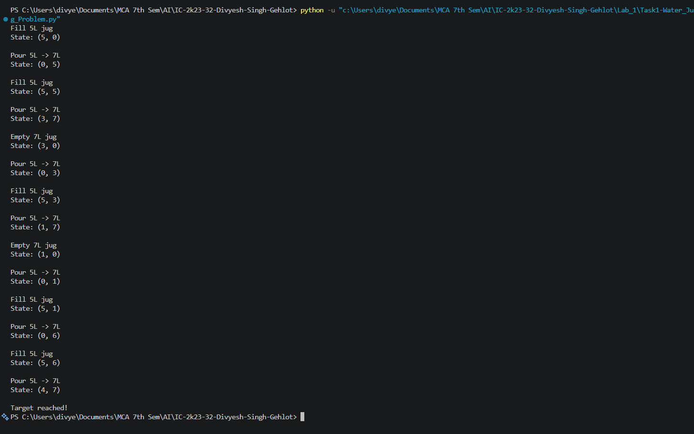

# 1. Water Jug Problem

## 1.1 Aim / Problem Statement

### Aim
To implement the **Water Jug Problem** in Python using an algorithmic approach and determine a sequence of operations that measures an exact target amount of water using two jugs of given capacities.

### Problem Statement
Given two water jugs with capacities `X` litres and `Y` litres, initially both empty, measure exactly `T` litres of water using:

1. Fill a jug completely.
2. Empty a jug completely.
3. Pour water from one jug into the other until either the source jug becomes empty or the destination jug becomes full.

### Example
```text
First Jug  = 5L
Second Jug = 7L
Target     = 4L
```

## 1.2 Algorithm

**State representation:** `(a, b)` where `a` = water in first jug, `b` = water in second jug. Initial state = `(0, 0)`.

### Pseudocode
```text
START
Set first_jug = 0
Set second_jug = 0

WHILE neither jug contains target:
    IF first_jug is empty:
        Fill first jug
    ELSE IF second_jug is full:
        Empty second jug
    ELSE:
        Pour water from first jug to second jug
    Display current state

Display "Target reached"
END
```

## 1.3 Implementation

```python
def water_jug(first_capacity, second_capacity, target):
    """
    Solve the Water Jug Problem using two jugs.

    Parameters:
        first_capacity (int): Capacity of the first jug.
        second_capacity (int): Capacity of the second jug.
        target (int): Required amount of water.
    """
    first_jug = 0
    second_jug = 0

    while first_jug != target and second_jug != target:

        if first_jug == 0:
            first_jug = first_capacity
            print(f"Fill {first_capacity}L jug")

        elif second_jug == second_capacity:
            second_jug = 0
            print(f"Empty {second_capacity}L jug")

        else:
            transferable_amount = min(first_jug, second_capacity - second_jug)
            first_jug -= transferable_amount
            second_jug += transferable_amount
            print(f"Pour {first_capacity}L -> {second_capacity}L jug")

        print(f"State: ({first_jug}, {second_jug})")
        print()


def validate_input(first_capacity, second_capacity, target):
    """Validate Water Jug Problem inputs."""
    if not isinstance(first_capacity, int):
        raise TypeError("First jug capacity must be an integer.")
    if not isinstance(second_capacity, int):
        raise TypeError("Second jug capacity must be an integer.")
    if not isinstance(target, int):
        raise TypeError("Target must be an integer.")
    if first_capacity <= 0 or second_capacity <= 0:
        raise ValueError("Jug capacities must be positive.")
    if target < 0:
        raise ValueError("Target cannot be negative.")
    if target > max(first_capacity, second_capacity):
        raise ValueError("Target cannot be greater than both jug capacities.")


def main():
    """Run the Water Jug Problem."""
    first_capacity = 5
    second_capacity = 7
    target = 4

    validate_input(first_capacity, second_capacity, target)
    water_jug(first_capacity, second_capacity, target)


if __name__ == "__main__":
    main()
```

## 1.4 Results / Output

**Input:** First Jug = 5L, Second Jug = 7L, Target = 4L

```text
Fill 5L jug
State: (5, 0)

Pour 5L -> 7L jug
State: (0, 5)

Fill 5L jug
State: (5, 5)

Pour 5L -> 7L jug
State: (3, 7)

Empty 7L jug
State: (3, 0)

Pour 5L -> 7L jug
State: (0, 3)

Fill 5L jug
State: (5, 3)

Pour 5L -> 7L jug
State: (1, 7)

Empty 7L jug
State: (1, 0)

Pour 5L -> 7L jug
State: (0, 1)

Fill 5L jug
State: (5, 1)

Pour 5L -> 7L jug
State: (0, 6)

Fill 5L jug
State: (5, 6)

Pour 5L -> 7L jug
State: (4, 7)

Target reached!
```

**Result:** Target of 4 litres reached. Final state: `(4, 7)`.

## 1.5 Performance Analysis

| Metric | Result |
|---|---|
| Accuracy / Precision / Recall / F1 / Confusion Matrix | Not Applicable (not a classification problem) |
| Number of Operations | 13 |
| Time Complexity | O(N) |
| Space Complexity | O(1) |

Classification metrics don't apply here since the algorithm performs deterministic state transitions rather than predicting labels — relevant measures instead are number of operations, states generated, and time/space complexity.

## 1.6 Screenshots / State Visualization

```text
(0,0) → (5,0) → (0,5) → (5,5) → (3,7) → (3,0) → (0,3) → (5,3)
→ (1,7) → (1,0) → (0,1) → (5,1) → (0,6) → (5,6) → (4,7)
```
