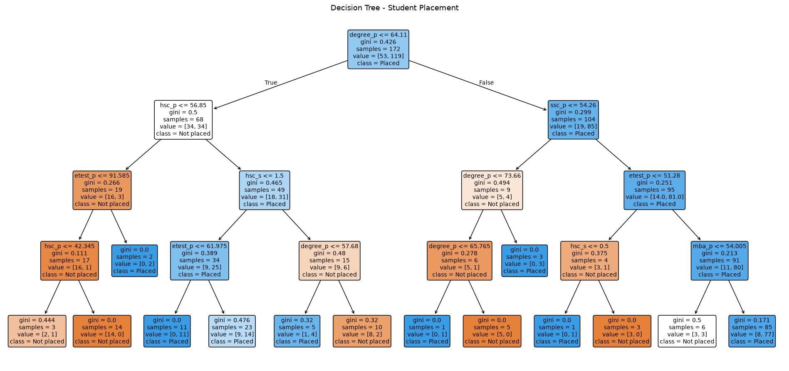
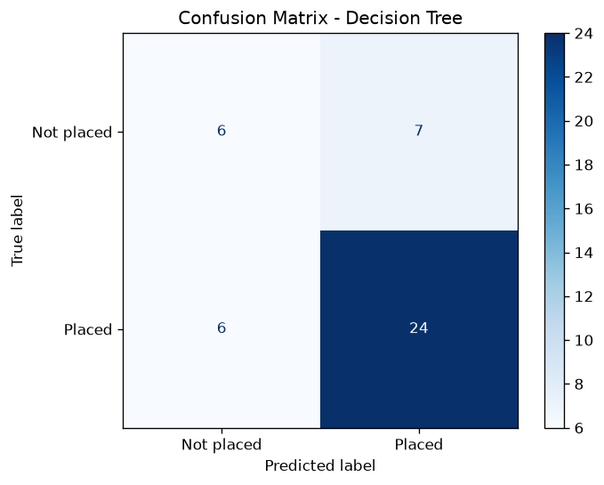
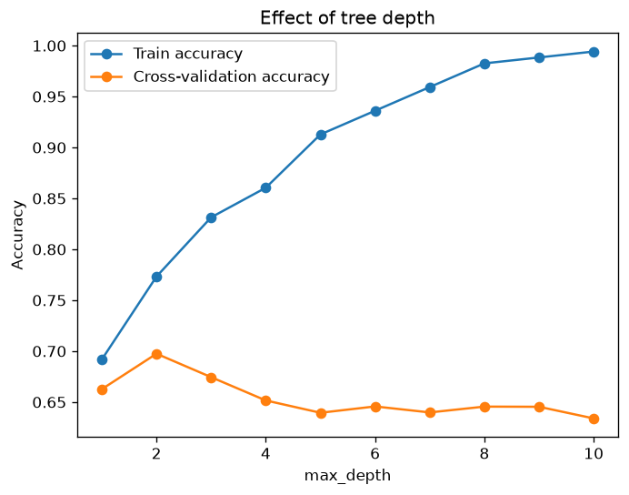
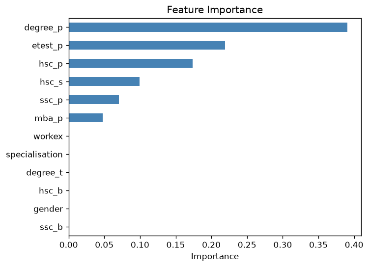

# 🌳 Lab 14 — Machine Learning for Intelligent Decision Making (Decision Tree)

## Overview

This lab predicts whether a student will be **placed** using a **Decision Tree Classifier**, evaluates the model with a confusion matrix and a classification report, and visualizes the tree. It continues the placement dataset prepared in Lab 9-11.

```text
Lab_14/
├── part1_train_decision_tree.py    # train and save the model
├── part2_evaluate_model.py         # metrics, confusion matrix, effect of tree depth
├── part3_visualize_tree.py         # tree rules, tree picture, feature importance
├── outputs/
│   ├── confusion_matrix.png
│   ├── decision_tree.png
│   ├── depth_vs_accuracy.png
│   └── feature_importance.png
└── README.md
datasets/placement_processed.csv    # produced in Lab 9-11
models/decision_tree.pkl            # produced by part 1
```

### How to Run

```bash
pip install pandas scikit-learn matplotlib joblib
cd Lab_14
python part1_train_decision_tree.py    # run first: it creates the saved model
python part2_evaluate_model.py
python part3_visualize_tree.py
```

> **Dataset note:** every number below comes from the **sample placement dataset generated in Lab 9-11** (215 students). If you replace it with the real Kaggle *Campus Recruitment* data, rerun all three parts and update the numbers in this README.

---

# 1. Aim / Problem Statement

### Aim

To build, evaluate and visualize a Decision Tree classifier that predicts student placement.

### Problem Statement

Given a student's academic record, predict whether the student is **Placed** or **Not placed**, measure how well the model does on students it has never seen, and show the rules the tree learned.

---

# 2. Dataset

| Item | Value |
|---|---|
| Source | `datasets/placement_processed.csv` (output of the Lab 9-11 pipeline: cleaned, imputed, label-encoded) |
| Rows / columns | 215 rows, 14 columns |
| Features used | 12: `gender`, `ssc_p`, `ssc_b`, `hsc_p`, `hsc_b`, `hsc_s`, `degree_p`, `degree_t`, `workex`, `etest_p`, `specialisation`, `mba_p` |
| Target | `status` (1 = Placed, 0 = Not placed) |
| Left out | `salary` — it is only known **after** a student is placed, so using it would leak the answer |
| Class balance | 149 Placed, 66 Not placed (69.3 % / 30.7 %) |
| Train / test split | 80 % / 20 % → 172 training rows, 43 test rows (30 Placed, 13 Not placed), stratified, `random_state = 42` |

---

# 3. Algorithm

A Decision Tree repeatedly asks a yes/no question about one feature (for example *degree_p ≤ 64.11?*). At every node it tries all features and thresholds and keeps the split that lowers the **Gini impurity** the most:

```text
Gini = 1 - (p_placed^2 + p_not_placed^2)
```

A node with Gini = 0 is **pure** (all students in it have the same label). Growth stops at `max_depth` or when a node is pure. A new student is sent down the tree and receives the majority label of the leaf they reach.

### Pseudocode

```text
START
Load the processed dataset
X = every column except status and salary
y = status
Split into 80 % training and 20 % test (stratified)

Train DecisionTreeClassifier(max_depth = 4):
    at each node, choose the feature and threshold with the lowest weighted Gini
    stop at max_depth or when the node is pure

Predict the test set
Report accuracy, precision, recall, F1 and the confusion matrix
Plot the tree and the feature importance
END
```

---

# 4. Implementation

The code is in the three `part*.py` files. The essential lines are shown here.

**Part 1 — train and save**

```python
X = data.drop(columns=["status", "salary"], errors="ignore")
y = data["status"]
X_train, X_test, y_train, y_test = train_test_split(
    X, y, test_size=0.2, random_state=42, stratify=y)
model = DecisionTreeClassifier(max_depth=4, random_state=42)
model.fit(X_train, y_train)
joblib.dump(model, "../models/decision_tree.pkl")
```

**Part 2 — evaluate, and test different tree depths**

```python
y_pred = model.predict(X_test)
cm = confusion_matrix(y_test, y_pred)
print(classification_report(y_test, y_pred, target_names=["Not placed", "Placed"]))

for d in depths:
    tree = DecisionTreeClassifier(max_depth=d, random_state=42)
    tree.fit(X_train, y_train)
    cv_scores.append(cross_val_score(tree, X_train, y_train, cv=5).mean())
```

**Part 3 — visualize**

```python
print(export_text(model, feature_names=list(X.columns)))
plot_tree(model, feature_names=list(X.columns),
          class_names=["Not placed", "Placed"],
          filled=True, rounded=True, fontsize=9)
```

---

# 5. Results / Output

### Part 1 — training

```text
Dataset shape: (215, 14)
Features: ['gender', 'ssc_p', 'ssc_b', 'hsc_p', 'hsc_b', 'hsc_s', 'degree_p', 'degree_t', 'workex', 'etest_p', 'specialisation', 'mba_p']
Placed: 149  Not placed: 66

Training rows: 172  Testing rows: 43

Tree depth      : 4
Number of leaves: 14
Train accuracy  : 86.05 %
Test accuracy   : 69.77 %

First test student predicted as: Placed | actual: Not placed

Model saved to ../models/decision_tree.pkl
```

### Part 2 — evaluation

```text
Accuracy : 0.6977
Precision: 0.7742
Recall   : 0.8
F1-score : 0.7869

Confusion matrix (rows = actual, columns = predicted):
[[ 6  7]
 [ 6 24]]
True negatives : 6 | False positives: 7
False negatives: 6 | True positives : 24

Classification report:
              precision    recall  f1-score   support

  Not placed       0.50      0.46      0.48        13
      Placed       0.77      0.80      0.79        30

    accuracy                           0.70        43
   macro avg       0.64      0.63      0.63        43
weighted avg       0.69      0.70      0.69        43

Baseline (always predict Placed): 0.6977

Depth  Train acc  CV acc (5-fold)
    1      0.692           0.663
    2      0.773           0.697
    3      0.831           0.674
    4      0.860           0.652
    5      0.913           0.639
    6      0.936           0.646
    7      0.959           0.640
    8      0.983           0.646
    9      0.988           0.645
   10      0.994           0.634

Saved plots to outputs/
```

### Part 3 — tree rules and feature importance

```text
Tree rules:

|--- degree_p <= 64.11
|   |--- hsc_p <= 56.85
|   |   |--- etest_p <= 91.58
|   |   |   |--- hsc_p <= 42.34
|   |   |   |   |--- class: 0
|   |   |   |--- hsc_p >  42.34
|   |   |   |   |--- class: 0
|   |   |--- etest_p >  91.58
|   |   |   |--- class: 1
|   |--- hsc_p >  56.85
|   |   |--- hsc_s <= 1.50
|   |   |   |--- etest_p <= 61.98
|   |   |   |   |--- class: 1
|   |   |   |--- etest_p >  61.98
|   |   |   |   |--- class: 1
|   |   |--- hsc_s >  1.50
|   |   |   |--- degree_p <= 57.68
|   |   |   |   |--- class: 1
|   |   |   |--- degree_p >  57.68
|   |   |   |   |--- class: 0
|--- degree_p >  64.11
|   |--- ssc_p <= 54.26
|   |   |--- degree_p <= 73.66
|   |   |   |--- degree_p <= 65.76
|   |   |   |   |--- class: 1
|   |   |   |--- degree_p >  65.76
|   |   |   |   |--- class: 0
|   |   |--- degree_p >  73.66
|   |   |   |--- class: 1
|   |--- ssc_p >  54.26
|   |   |--- etest_p <= 51.28
|   |   |   |--- hsc_s <= 0.50
|   |   |   |   |--- class: 1
|   |   |   |--- hsc_s >  0.50
|   |   |   |   |--- class: 0
|   |   |--- etest_p >  51.28
|   |   |   |--- mba_p <= 54.00
|   |   |   |   |--- class: 0
|   |   |   |--- mba_p >  54.00
|   |   |   |   |--- class: 1

Feature importance:
degree_p          0.390
etest_p           0.219
hsc_p             0.173
hsc_s             0.099
ssc_p             0.071
mba_p             0.048
ssc_b             0.000
gender            0.000
degree_t          0.000
hsc_b             0.000
workex            0.000
specialisation    0.000

Saved decision_tree.png and feature_importance.png to outputs/
```

---

# 6. Performance Analysis

### Test-set metrics (43 students)

| Metric | Result |
|---|---|
| Accuracy | 0.6977 (69.77 %) |
| Precision (Placed) | 0.7742 |
| Recall (Placed) | 0.8000 |
| F1-score (Placed) | 0.7869 |
| Precision / Recall / F1 (Not placed) | 0.50 / 0.46 / 0.48 |
| Macro-average F1 | 0.63 |
| Baseline accuracy (always predict Placed) | 0.6977 |
| Train accuracy (depth 4) | 0.8605 |
| Tree depth / leaves | 4 / 14 |

### Confusion matrix

|  | Predicted: Not placed | Predicted: Placed |
|---|---|---|
| **Actual: Not placed** | 6 (true negatives) | 7 (false positives) |
| **Actual: Placed** | 6 (false negatives) | 24 (true positives) |

### Feature importance

| Feature | Importance |
|---|---|
| `degree_p` | 0.390 |
| `etest_p` | 0.219 |
| `hsc_p` | 0.173 |
| `hsc_s` | 0.099 |
| `ssc_p` | 0.071 |
| `mba_p` | 0.048 |
| the other 6 features | 0.000 (never used) |

---

# 7. Screenshots / Graphs / Visualization

### Decision tree



### Confusion matrix



### Effect of tree depth



### Feature importance



---

# 8. Analysis (Homework)

## 8.1 Evaluate Decision Tree Performance

**1. On unseen students the tree is no better than always guessing "Placed".**
Its test accuracy (69.77 %) is exactly the accuracy of a model that predicts "Placed" for everyone (69.77 %). With only 43 test students, one student is worth about 2.3 percentage points, and the accuracy carries an uncertainty of roughly ±7 points (one standard error), so the result cannot show that the tree is genuinely better or worse than the baseline.

**2. The tree overfits.**
Training accuracy is 86.05 % but test accuracy is 69.77 %, a gap of about 16 points. The depth experiment shows the same thing:

| max_depth | Train accuracy | Cross-validation accuracy |
|---|---|---|
| 1 | 0.692 | 0.663 |
| 2 | 0.773 | **0.697** |
| 3 | 0.831 | 0.674 |
| 4 | 0.860 | 0.652 |
| 6 | 0.936 | 0.646 |
| 10 | 0.994 | 0.634 |

Making the tree deeper pushes training accuracy from 0.69 to 0.99, while cross-validation accuracy peaks at depth 2 (0.697) and then falls. The extra splits memorise individual students instead of finding real patterns. The depth of 4 used in part 1 was chosen to make the tree readable, not because it generalises best; depth 2 or 3 would be a better choice.

**3. Some leaves rest on very few students.**
9 of the tree's 14 leaves contain only 1 to 6 training students (two contain a single student), so their predictions are fragile.

**4. The model is weak where it matters.**
It finds 80 % of the placed students but only 46 % of the students who were *not* placed.

## 8.2 Compare Different Evaluation Metrics

The same predictions were scored against the trivial "always Placed" baseline:

| Metric | Decision tree | Always "Placed" |
|---|---|---|
| Accuracy | 0.698 | 0.698 |
| Balanced accuracy | 0.631 | 0.500 |
| Placed: precision / recall / F1 | 0.774 / 0.800 / 0.787 | 0.698 / 1.000 / 0.822 |
| Not placed: precision / recall / F1 | 0.500 / 0.462 / 0.480 | 0.000 / 0.000 / 0.000 |
| Macro-average F1 | 0.633 | 0.411 |

What each metric tells us:

* **Accuracy** hides the problem completely: the tree and the baseline tie, even though the baseline never identifies a single student who was not placed.
* **Balanced accuracy** and **macro F1** average over both classes, so they expose the difference: the tree (0.631 / 0.633) is clearly better than the baseline (0.500 / 0.411).
* **F1 for the "Placed" class alone** ranks the baseline *higher* (0.822 vs 0.787), because a model that predicts "Placed" for everyone has perfect recall for that class. Looking at only one class's F1 can therefore reward a useless model.
* **Recall of "Not placed"** is the metric to watch if the goal is to find students at risk of not being placed (0.46 here). **Precision of "Placed"** matters more if a false promise of placement is costly (0.77 here).

**Conclusion:** no single number is enough. For an imbalanced dataset like this one (about 70:30), report the confusion matrix together with balanced accuracy or macro F1, and choose the headline metric by the cost of each kind of mistake.

---

# 9. Learning Outcomes

* Trained and tested a Decision Tree classifier with scikit-learn using a stratified train-test split.
* Read a confusion matrix and computed accuracy, precision, recall and F1 from it.
* Visualized a tree and read its rules and feature importances.
* Recognised overfitting from the gap between training and test accuracy and from the depth experiment.
* Learned to compare a model against a trivial baseline and to choose evaluation metrics for imbalanced classes.
* Avoided data leakage by leaving out `salary`.

---

# 10. Conclusion

A Decision Tree was trained on the Lab 9-11 placement data and visualized. It overfits (86 % train vs 70 % test) and matches the always-"Placed" baseline on accuracy, but balanced accuracy and macro F1 show that it does separate the two classes better than the baseline. Depth selection with cross-validation suggests a shallower tree (depth 2 to 3). The same model is explained in **Lab 16**.