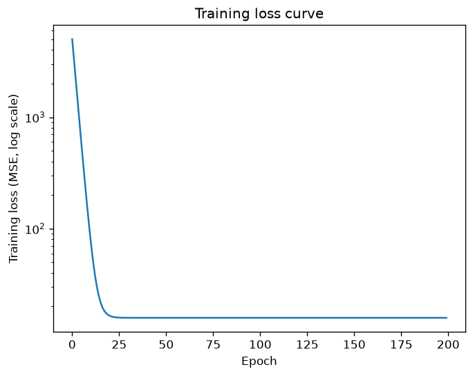
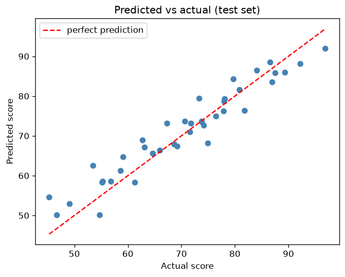
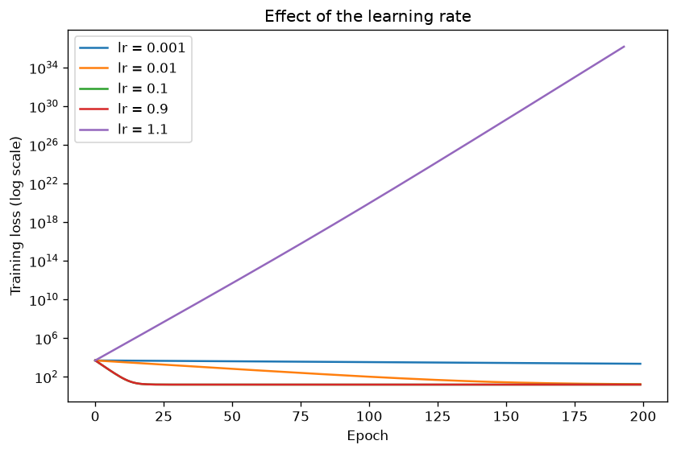

# 🔥 Lab 15 — Deep Learning Fundamentals using PyTorch

## Overview

This lab introduces PyTorch step by step: tensor manipulation, automatic differentiation (gradients), a linear regression model trained with a hand-written training loop, model evaluation, and an analysis comparing PyTorch with traditional machine learning and studying how the learning rate affects convergence.

```text
Lab_15/
├── part1_tensors.py               # tensor manipulation
├── part2_gradients.py             # gradient computation with autograd
├── part3_linear_regression.py     # model, training loop, evaluation, saved model
├── part4_analysis.py              # PyTorch vs scikit-learn, learning-rate study
├── student_data.py                # helper: makes / loads / splits / scales the data
├── outputs/
│   ├── loss_curve.png
│   ├── predicted_vs_actual.png
│   └── learning_rate_comparison.png
└── README.md
datasets/student_scores.csv        # created on first run
models/linear_regression.pt        # created by part 3
```

### How to Run

```bash
pip install torch numpy pandas scikit-learn matplotlib
cd Lab_15
python part1_tensors.py
python part2_gradients.py
python part3_linear_regression.py      # creates the dataset and the saved model
python part4_analysis.py
```

---

# 1. Aim / Problem Statement

### Aim

To learn the building blocks of PyTorch (tensors, autograd, loss functions, optimizers) and use them to train a linear regression model.

### Problem Statement

Predict a student's exam **score** from **hours studied** and **attendance**, train the model with gradient descent, evaluate it on unseen students, and study how well and how fast it learns.

---

# 2. Dataset

The data is generated by `student_data.py` using a **known rule plus noise**, so we can check whether the model recovers the true relationship:

```text
score = 20 + 5 * hours_studied + 0.3 * attendance + noise      (noise ~ Normal(0, 4), score clipped to 0-100)
```

| Item | Value |
|---|---|
| Rows | 200 (160 training, 40 test, shuffled with a fixed seed) |
| Features | `hours_studied` (1–10), `attendance` (50–100) |
| Target | `score` |
| Scaling | features are standardised using the **training** mean and standard deviation only (the test set never influences the scaling) |

> The dataset is synthetic. It is meant for learning the PyTorch workflow, not for drawing conclusions about real students.

---

# 3. Algorithm

**Model:** `score = w1 * hours + w2 * attendance + b` (a single `nn.Linear(2, 1)` layer).

**Loss:** Mean Squared Error, `MSE = mean((prediction - actual)^2)`.

**Gradient descent:** repeatedly move every parameter a small step against its gradient:

```text
parameter = parameter - learning_rate * d(loss)/d(parameter)
```

PyTorch computes the gradients automatically (`loss.backward()`), so no formulas have to be written by hand.

### Pseudocode

```text
START
Load data, split into train and test, scale the features
Create the model (random weights), the MSE loss and the SGD optimizer

REPEAT for each epoch:
    prediction = model(training features)       # forward pass
    loss = MSE(prediction, training scores)
    clear the old gradients
    compute new gradients (backward pass)
    update the weights (optimizer step)

Evaluate on the test set: MSE, RMSE, MAE, R2
Convert the weights back to original units
Save the model
END
```

---

# 4. Implementation

The code is in the `part*.py` files. The essential lines are shown here.

**Part 2 — gradient computation**

```python
x = torch.tensor(2.0, requires_grad=True)
y = x ** 2 + 3 * x + 1
y.backward()
# x.grad now holds dy/dx = 2x + 3 = 7
```

**Part 3 — model and training loop**

```python
model = nn.Linear(2, 1)                 # score = w1*hours + w2*attendance + b
loss_fn = nn.MSELoss()
optimizer = torch.optim.SGD(model.parameters(), lr=0.1)

for epoch in range(epochs):
    prediction = model(X_train)             # 1. forward pass
    loss = loss_fn(prediction, y_train)     # 2. compute loss
    optimizer.zero_grad()                   # 3. clear old gradients
    loss.backward()                         # 4. compute new gradients
    optimizer.step()                        # 5. update weights
```

**Part 4 — comparison with scikit-learn and learning-rate study**

```python
sk = LinearRegression().fit(d["X_train"], d["y_train"])
for lr in [0.001, 0.01, 0.1, 0.9, 1.1]:
```

---

# 5. Results / Output

### Part 1 — tensor manipulation (first part of the output)

```text
1. Creating tensors
a    = tensor([1, 2, 3, 4])
b    =
 tensor([[1., 2., 3.],
        [4., 5., 6.]])
zeros=
 tensor([[0., 0., 0.],
        [0., 0., 0.]])
seq  = tensor([0, 2, 4, 6, 8])
rand =
 tensor([[0.8823, 0.9150, 0.3829],
        [0.9593, 0.3904, 0.6009]])

2. Shape and dtype
b.shape = torch.Size([2, 3]) | b.dtype = torch.float32 | b.ndim = 2
a.dtype = torch.int64
a as float = tensor([1., 2., 3., 4.])

3. Reshaping
x         = tensor([ 0,  1,  2,  3,  4,  5,  6,  7,  8,  9, 10, 11])
reshape(3, 4) =
 tensor([[ 0,  1,  2,  3],
        [ 4,  5,  6,  7],
        [ 8,  9, 10, 11]])
reshape(2, 2, 3) shape = torch.Size([2, 2, 3])

4. Indexing and slicing
m =
 tensor([[ 1,  2,  3,  4],
        [ 5,  6,  7,  8],
        [ 9, 10, 11, 12]])
m[0]      = tensor([1, 2, 3, 4])
m[1, 2]   = tensor(7)
m[:, 1]   = tensor([ 2,  6, 10])
m[1:, :2] =
 tensor([[ 5,  6],
        [ 9, 10]])
m[m > 6]  = tensor([ 7,  8,  9, 10, 11, 12])

5. Arithmetic
p + q = tensor([5., 7., 9.])
p * q = tensor([ 4., 10., 18.])
p ** 2 = tensor([1., 4., 9.])
...
```

### Part 2 — gradient computation

```text
1. y = x^2 + 3x + 1 at x = 2
   y = 11.0
   dy/dx from PyTorch = 7.0
   dy/dx by hand (2x + 3) = 7

2. Gradients of the loss
   prediction = 3.5 | loss = 42.25
   dloss/dw from PyTorch = -39.0
   dloss/db from PyTorch = -13.0
   dloss/dw by hand      = -39.0
   dloss/db by hand      = -13.0

3. Gradients accumulate (out = 5 * z, so the gradient is 5 each time)
   after backward() call 1: z.grad = 5.0
   after backward() call 2: z.grad = 10.0
   after backward() call 3: z.grad = 15.0
   after zero_(): z.grad = 0.0

4. One gradient descent step (lr = 0.01)
   w: 1.0 -> 1.39
   b: 0.5 -> 0.63
   loss before: 42.25 | loss after: 27.04

5. Inside no_grad(), requires_grad = False
```

### Part 3 — training and evaluation

```text
Dataset not found, creating ../datasets/student_scores.csv
Training rows: 160 | Testing rows: 40

Epoch    Loss
    1  5013.2998
   20    16.8650
   40    15.8291
   60    15.8290
   80    15.8290
  100    15.8290
  120    15.8290
  140    15.8290
  160    15.8290
  180    15.8290
  200    15.8290

Learned rule (original units):
  score = 19.56 + 5.09 * hours + 0.299 * attendance
True rule used to make the data:
  score = 20.00 + 5.00 * hours + 0.300 * attendance

Test set evaluation:
  MSE  = 15.231
  RMSE = 3.903  (average error in marks)
  MAE  = 3.168
  R2   = 0.9063

Student with 6 hours and 80% attendance -> predicted score 74.0

Model saved to ../models/linear_regression.pt
Plots saved to outputs/
```

### Part 4 — analysis

```text
(a) PyTorch vs scikit-learn on the test set
Model                MSE      R2
PyTorch (SGD)      15.231  0.9063
scikit-learn       15.231  0.9063

Learned weights (scaled features):
PyTorch     : [13.257  4.269] 69.269
scikit-learn: [13.257  4.269] 69.269

(b) Training loss after different numbers of epochs
Learning rate    10 epochs   50 epochs  200 epochs
       0.001     4836.379    4122.830    2.27e+03
        0.01     3489.471     705.625        17.4
         0.1      105.771      15.829        15.8
         0.9      106.996      15.829        15.8
         1.1   134355.781 336763027456.000         inf

Saved outputs/learning_rate_comparison.png
```

---

# 6. Performance Analysis

### Test-set evaluation (40 students)

| Metric | Result |
|---|---|
| MSE | 15.231 |
| RMSE | 3.903 marks |
| MAE | 3.168 marks |
| R² | 0.9063 |
| Final training loss (MSE) | 15.829 |

### Did the model recover the true rule?

| Parameter | True value | Learned value |
|---|---|---|
| Intercept | 20.00 | 19.56 |
| Hours studied | 5.00 | 5.09 |
| Attendance | 0.300 | 0.299 |

### Training loss over time

| Epoch | Loss |
|---|---|
| 1 | 5013.30 |
| 20 | 16.87 |
| 40 | 15.83 |
| 60 to 200 | 15.829 (no further change) |

The training MSE settles at about 15.8, which is close to the variance of the noise added to the data (4² = 16). That is the best any model can do on this data, so the model has learned essentially everything that can be learned.

---

# 7. Screenshots / Graphs / Visualization

### Training loss curve



### Predicted vs actual scores (test set)



### Effect of the learning rate



---

# 8. Analysis (Homework)

## 8.1 Compare Traditional ML and Deep Learning Models

The same data and split were used for a PyTorch model (trained with SGD) and scikit-learn's `LinearRegression`:

| Model | Test MSE | Test R² | Weights (scaled features) | Bias |
|---|---|---|---|---|
| PyTorch (SGD, 200 epochs) | 15.231 | 0.9063 | 13.257, 4.269 | 69.269 |
| scikit-learn | 15.231 | 0.9063 | 13.257, 4.269 | 69.269 |

* **The two models are identical** (to every digit shown). This is expected: a linear model has exactly one best solution. scikit-learn finds it directly with a closed-form least-squares calculation, while PyTorch walks towards it step by step with gradient descent and arrives at the same place.
* **For this problem the PyTorch version adds no accuracy.** It needs a learning rate, a number of epochs and a training loop, while scikit-learn needs one line.
* **Where PyTorch becomes worthwhile:** when the relationship is non-linear (add layers and activation functions), when the data is very large (mini-batch training), or when the model is a neural network that has no closed-form solution. The training loop written here (forward pass, loss, `zero_grad`, `backward`, `step`) is the same loop used for those larger models.

## 8.2 Analyze the Convergence of Gradient-Based Learning

Training loss after different numbers of epochs for five learning rates:

| Learning rate | 10 epochs | 50 epochs | 200 epochs | Behaviour |
|---|---|---|---|---|
| 0.001 | 4836.4 | 4122.8 | 2270 | far too slow, not converged |
| 0.01 | 3489.5 | 705.6 | 17.4 | converging slowly: still above the minimum (15.8) after 200 epochs |
| 0.1 | 105.8 | 15.8 | 15.8 | converges quickly |
| 0.9 | 107.0 | 15.8 | 15.8 | converges quickly |
| 1.1 | 134,356 | 3.4 × 10¹¹ | inf | **diverges** |

* **Too small a step wastes time.** With `lr = 0.001` the loss is still above 2,000 after 200 epochs.
* **A good step converges in a few dozen epochs.** Both 0.1 and 0.9 reach the minimum (15.8) by epoch 50, and the curve then stays flat.
* **Too large a step makes the loss explode.** At `lr = 1.1` each update overshoots the minimum by more than it corrects, the error grows every epoch, and the loss reaches `inf`.
* **Why the limit is just below 1 here:** the features are standardised (variance 1), so the largest curvature of the MSE loss is about 2.02. Gradient descent is stable only when `lr` is below 2 divided by that curvature, which is about 0.99. The experiment agrees: 0.9 converges and 1.1 diverges.
* **Feature scaling mattered.** A separate quick test (not part of the lab files) trained the same model on the *unscaled* features (hours 1–10, attendance 50–100). The curvature of the loss then rises from about 2 to about 11,400, so training is stable only for `lr` below about 0.00018, roughly 5,000 times smaller than with scaled features. Learning rates of 0.1, 0.01 and 0.001 all diverged to `nan`, and even `lr = 0.0001` was still at a loss of 133 after 200 epochs, while the scaled model reached 15.8 within 50 epochs.

---

# 9. Learning Outcomes

* Created, reshaped, indexed and combined tensors, and converted between NumPy and PyTorch.
* Used automatic differentiation and checked PyTorch's gradients against hand-calculated ones.
* Understood why gradients accumulate and why `optimizer.zero_grad()` is needed.
* Wrote a complete training loop and evaluated a model with MSE, RMSE, MAE and R².
* Compared a PyTorch model with scikit-learn and understood when each is appropriate.
* Saw how the learning rate controls convergence, from too slow to diverging.

---

# 10. Conclusion

A linear regression model was trained in PyTorch with a hand-written training loop. It recovered the hidden rule almost exactly (19.56 + 5.09·hours + 0.299·attendance against the true 20 + 5·hours + 0.3·attendance) with R² = 0.906 on unseen students, and matched scikit-learn to every digit. The learning-rate study showed that gradient descent converges quickly at a good step size, crawls at a tiny one, and diverges when the step is too large.