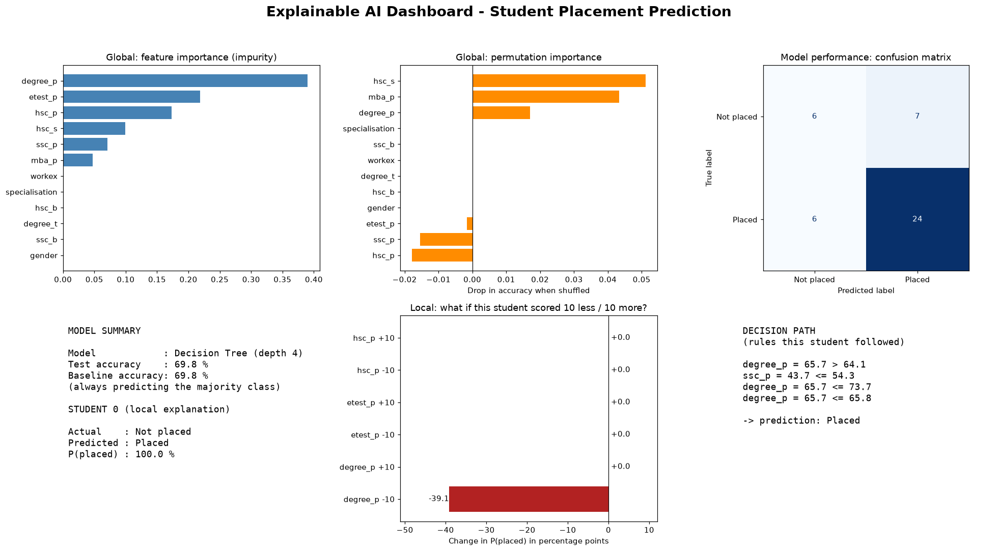
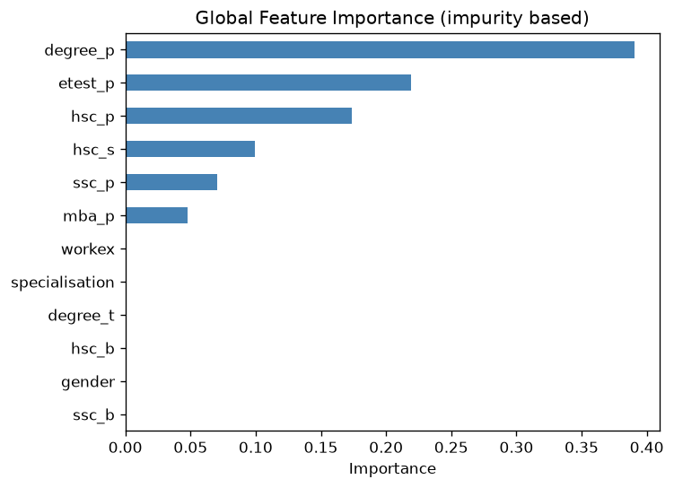
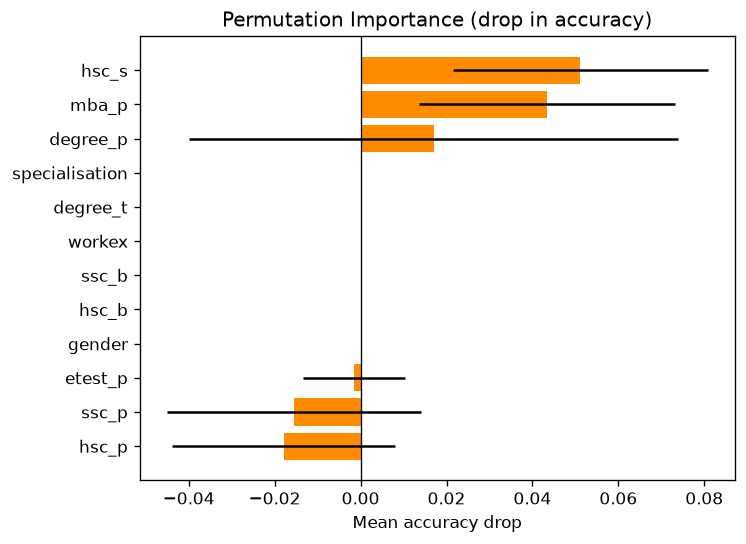

# 🔍 Lab 16 — Explainable AI Dashboard (Mini Project)

## Overview

Unit 7 asks for **one** application out of five (medical image classification, traffic sign recognition, face recognition, an explainable AI dashboard, or an adversarial attack detection system). This lab implements the **Explainable AI Dashboard**. It was chosen because it needs no image dataset or GPU, and it explains the Decision Tree built in Lab 14, so the whole project runs in seconds.

The dashboard shows *what the model relies on* (global explanations), *why it made one particular prediction* (local explanation), and *how good it actually is* (performance).

```text
Lab_16/
├── xai_data.py                       # helper: loads the data and trains the Lab 14 tree
├── part1_global_importance.py        # impurity-based feature importance
├── part2_permutation_importance.py   # permutation importance on the test set
├── part3_explain_one_student.py      # decision path + what-if analysis for one student
├── part4_dashboard.py                # combines everything into one dashboard image
├── outputs/
│   ├── global_importance.png
│   ├── permutation_importance.png
│   └── xai_dashboard.png
└── README.md
datasets/placement_processed.csv      # produced in Lab 9-11
```

### How to Run

```bash
pip install pandas scikit-learn matplotlib
cd Lab_16
python part1_global_importance.py
python part2_permutation_importance.py
python part3_explain_one_student.py          # optional: add a test-student number, e.g. 5
python part4_dashboard.py                    # produces outputs/xai_dashboard.png
```

> **Dataset note:** all numbers below come from the sample placement data generated in Lab 9-11. If you replace it with the real dataset, rerun everything and update the numbers and the interpretation, because explanations of a different model will differ.

---

# 1. Aim / Problem Statement

### Aim

To build an explainable AI dashboard that opens up the Decision Tree from Lab 14 and shows what it relies on and why it predicts what it does.

### Problem Statement

A model that only outputs "Placed" or "Not placed" cannot be trusted or debugged. The dashboard must answer three questions: **Which features does the model use?** (global), **Why this prediction for this student?** (local), and **Is the model any good?** (performance).

---

# 2. Dataset and Model

| Item | Value |
|---|---|
| Data | `datasets/placement_processed.csv`, 12 features, target `status` (salary excluded) |
| Split | 80 % train, 20 % test (43 students), stratified, `random_state = 42` — the same as Lab 14 |
| Model | `DecisionTreeClassifier(max_depth=4)` |
| Test accuracy | 69.77 %, the same as a baseline that always predicts "Placed" (69.77 %) |

The model is a weak one on this data (see Lab 14). The dashboard is built to explain whatever model it is given, and here it also reveals that weakness.

---

# 3. Methods

| Technique | Scope | Idea |
|---|---|---|
| **Impurity importance** | Global | How much each feature reduced the Gini impurity across all the splits where the tree used it (measured on training data) |
| **Permutation importance** | Global | Shuffle one feature in the **test** data; the drop in accuracy shows how much the model depends on it (repeated 30 times) |
| **Decision path** | Local | The exact sequence of rules one student followed down the tree |
| **What-if analysis** | Local | Change one feature of one student by ±10 and see how the predicted probability changes |

### Pseudocode (permutation importance)

```text
baseline = accuracy of the model on the test set
FOR EACH feature:
    REPEAT 30 times:
        shuffle that feature's column in the test set
        score = accuracy on the shuffled data
        drop = baseline - score
    importance = average drop (and its standard deviation)
```

---

# 4. Implementation

The code is in the `part*.py` files. The essential lines are shown here.

**Part 2 — permutation importance**

```python
result = permutation_importance(model, X_test, y_test, n_repeats=30,
                                random_state=42, scoring="accuracy")
```

**Part 3 — decision path and what-if analysis**

```python
path = model.decision_path(student)
nodes = path.indices[path.indptr[0]:path.indptr[1]]
leaf = model.apply(student)[0]

changed = student.copy()
changed[feature] = min(max(changed[feature].iloc[0] + change, 0), 100)
new_probability = model.predict_proba(changed)[0][1]
```

**Part 4 — dashboard layout**

```python
fig, axes = plt.subplots(2, 3, figsize=(18, 10))
```

---

# 5. Results / Output

### Part 1 — global (impurity) importance

```text
Model test accuracy: 69.77 %

Impurity-based feature importance:
degree_p          0.390
etest_p           0.219
hsc_p             0.173
hsc_s             0.099
ssc_p             0.071
mba_p             0.048
ssc_b             0.000
gender            0.000
degree_t          0.000
hsc_b             0.000
workex            0.000
specialisation    0.000

Features used by the tree: 6 of 12
Top 3 features explain 78.3 % of the splits

Saved outputs/global_importance.png
```

### Part 2 — permutation importance

```text
Drop in test accuracy when a feature is shuffled (30 repeats):

                permutation_mean  permutation_std  impurity
hsc_s                      0.051            0.030     0.099
mba_p                      0.043            0.030     0.048
degree_p                   0.017            0.057     0.390
gender                     0.000            0.000     0.000
degree_t                   0.000            0.000     0.000
workex                     0.000            0.000     0.000
ssc_b                      0.000            0.000     0.000
hsc_b                      0.000            0.000     0.000
specialisation             0.000            0.000     0.000
etest_p                   -0.002            0.012     0.219
ssc_p                     -0.016            0.030     0.071
hsc_p                     -0.018            0.026     0.173

Rank by impurity importance   : ['degree_p', 'etest_p', 'hsc_p']
Rank by permutation importance: ['hsc_s', 'mba_p', 'degree_p']

Shuffling these features did not hurt accuracy: ['gender', 'degree_t', 'workex', 'ssc_b', 'hsc_b', 'specialisation', 'etest_p', 'ssc_p', 'hsc_p']

Saved outputs/permutation_importance.png
```

### Part 3 — explanation of one student (test student 0)

```text
Test student number 0
Actual status   : Not placed
Predicted status: Placed
Probability of being placed: 100.0 %

Student details:
                value
gender           0.00
ssc_p           43.66
ssc_b            1.00
hsc_p           72.04
hsc_b            0.00
hsc_s            0.00
degree_p        65.65
degree_t         1.00
workex           0.00
etest_p         94.62
specialisation   1.00
mba_p           55.40

Rules followed by the tree:
  degree_p = 65.65 > 64.11
  ssc_p = 43.66 <= 54.26
  degree_p = 65.65 <= 73.66
  degree_p = 65.65 <= 65.76
  -> reaches a leaf and predicts Placed

What-if: change one important feature and see the probability
Feature        Change    New probability   Difference
degree_p       -10        60.9 %         -39.1 %
degree_p       +10       100.0 %          +0.0 %
etest_p        -10       100.0 %          +0.0 %
etest_p        +10       100.0 %          +0.0 %
hsc_p          -10       100.0 %          +0.0 %
hsc_p          +10       100.0 %          +0.0 %
```

### Part 4 — dashboard

```text
Dashboard saved to outputs/xai_dashboard.png
Test accuracy 69.8 % vs baseline 69.8 %
```

---

# 6. Performance Analysis

### Global importance: the two methods compared

| Feature | Impurity importance | Permutation importance (mean ± std) |
|---|---|---|
| `degree_p` | **0.390** | 0.017 ± 0.057 |
| `etest_p` | 0.219 | −0.002 ± 0.012 |
| `hsc_p` | 0.173 | −0.018 ± 0.026 |
| `hsc_s` | 0.099 | **0.051 ± 0.030** |
| `ssc_p` | 0.071 | −0.016 ± 0.030 |
| `mba_p` | 0.048 | **0.043 ± 0.030** |
| the other 6 features | 0.000 | 0.000 |

### Model performance (shown in the dashboard)

| Metric | Value |
|---|---|
| Test accuracy | 69.8 % |
| Baseline accuracy (always "Placed") | 69.8 % |
| Confusion matrix | 6 true negatives, 7 false positives, 6 false negatives, 24 true positives |

---

# 7. Screenshots / Graphs / Visualization

### The dashboard



The six panels are: impurity importance, permutation importance, confusion matrix, model summary with the explained student, the what-if bars, and the decision path.

### Global importance



### Permutation importance



---

# 8. Analysis (Homework)

## 8.1 Compare Explainable AI Techniques

| Technique | Scope | Works on | Measured on | Strengths | Weaknesses |
|---|---|---|---|---|---|
| Impurity importance | Global | Tree-based models only | Training data | Free, instant | Can overstate features the tree used to memorise the training data |
| Permutation importance | Global | Any model | Test data | Shows reliance on **unseen** data; model-independent | Noisy with a small test set; correlated features share credit |
| Decision path | Local | Trees only | One student | Exact, readable rules | Only explains a tree, and says nothing about how stable the rules are |
| What-if analysis | Local | Any model | One student | Intuitive ("what would change the answer?") | Only tests the changes you choose; changing one feature at a time ignores interactions |

**What the comparison revealed in this lab**

* **The two global methods disagree.** Impurity importance ranks `degree_p`, `etest_p` and `hsc_p` as the top three features. Permutation importance on the test set finds that shuffling `etest_p`, `ssc_p` and `hsc_p` does not hurt accuracy at all (the changes are slightly negative). The tree uses these features, but its use of them does not help on students it has not seen, which is a sign of the overfitting found in Lab 14. Impurity importance is computed on the training data and so cannot detect this.
* **The permutation results are themselves uncertain.** `hsc_s` (0.051 ± 0.030) and `mba_p` (0.043 ± 0.030) come out on top, but their standard deviations are large compared with their means, and the test set has only 43 students. Treat these rankings as weak evidence, not as findings. The disagreement between the two methods is more trustworthy than either ranking on its own.
* **A single prediction can look more certain than it is.** Student 0 is predicted "Placed" with 100 % probability, but was actually *not* placed. The decision path shows why this is misleading: the student's `degree_p` of 65.65 sits only 0.115 below the split threshold of 65.765, and the leaf the student falls into contains **just one training student**. A "100 %" probability from a decision tree only reports the purity of its leaf, not real confidence.
* **What-if analysis confirms the fragility.** Lowering `degree_p` by 10 marks drops the probability from 100 % to 60.9 % (−39.1 points), because the student moves to a different branch. Changing `etest_p` or `hsc_p` by ±10 changes nothing, because those features do not appear on this student's decision path.

**Conclusion:** the techniques complement each other. Impurity importance is a quick first look, permutation importance checks whether the model's reliance holds up on unseen data, and the local methods explain individual decisions and expose fragile ones. Using more than one technique caught problems that any single one would have hidden.

## 8.2 Other Unit 7 analysis topics

The Unit 7 syllabus also lists *robustness against adversarial attacks* and *PCA compared with feature extraction*. These belong to the CNN-based parts of Unit 7 (Grad-CAM, FGSM, ResNet, PCA/SVD) and are **not covered by this tabular dashboard project**.

---

# 9. Learning Outcomes

* Explained a model globally (feature importance) and locally (decision path and what-if analysis).
* Understood the difference between impurity importance (training data) and permutation importance (test data), and why they can disagree.
* Learned that a probability from a decision tree is not the same as confidence.
* Built a multi-panel dashboard with Matplotlib that combines explanation and performance.
* Learned to be cautious about conclusions drawn from a small test set.

---

# 10. Conclusion

An explainable AI dashboard was built for the Lab 14 Decision Tree. It combines impurity and permutation importance, a confusion matrix, a decision-path explanation and a what-if analysis for an individual student. Its most valuable result is a warning: the two importance methods disagree, which exposes that the tree relies on features that do not generalise, and the "100 % confident" prediction for student 0 rests on a single training student. Explanations are only as trustworthy as the model they explain, so the next step would be to repeat the dashboard on the real placement dataset and on a better-regularised model.